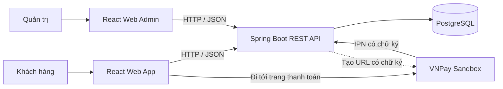
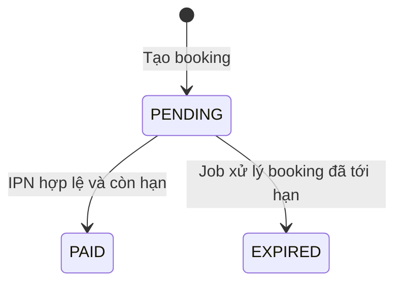

# Quản lý sân cầu lông — Tổng quan, kịch bản demo và hỏi đáp bảo vệ

> Đối chiếu source trên nhánh `feature/booking-engine`, ngày 22/10/2026.
> Tài liệu đặt tại thư mục gốc, bên ngoài các module backend/frontend.
> Dùng để chuẩn bị thuyết trình; chức năng có trong thiết kế DB và chức năng đã triển khai được phân biệt riêng.

## 1. Bài giới thiệu khoảng 60 giây

> Đồ án của nhóm em là hệ thống quản lý sân cầu lông. Hệ thống hỗ trợ khách hàng tìm sân, xem khung giờ, tạo lịch đặt và thanh toán qua VNPay Sandbox. Phía quản trị có các nhóm chức năng quản lý sân, khung giờ, hàng hóa, bán tại quầy, nhập kho và báo cáo doanh thu.
>
> Frontend dùng React, backend dùng Spring Boot và dữ liệu lưu trong PostgreSQL. Hai phía trao đổi bằng REST API. Backend tổ chức theo các tầng Controller, Service và Repository.
>
> Điểm nhóm em tập trung ở phần đặt sân là xử lý hai khách cùng đặt một khung giờ, giữ chỗ có thời hạn, tính giá từ dữ liệu phía server và xác minh thanh toán từ cổng thanh toán. Nhóm có các kiểm thử trên PostgreSQL để kiểm tra tranh chấp slot, rollback, hết hạn và callback thanh toán lặp.
>
> Hiện frontend khách hàng đã nối các màn Trang chủ, đăng ký, đăng nhập, tìm sân, xác nhận đặt sân và kết quả thanh toán. Một số màn như hồ sơ và lịch sử đầy đủ vẫn đang hoàn thiện.

## 2. Câu hỏi quan trọng nhất: Đồ án có theo MVC không?

### Câu trả lời nên dùng khi giảng viên hỏi

> Backend của nhóm em dùng Spring Web MVC để xây dựng REST API và được tổ chức theo kiến trúc phân tầng Controller–Service–Repository. Giao diện là React SPA chạy riêng, gọi API để nhận JSON và hiển thị dữ liệu. Vì vậy, mô tả đầy đủ là ứng dụng client–server, backend theo tầng và dựa trên Spring MVC; giao diện không được backend render bằng JSP hoặc Thymeleaf.

### Giải thích nếu được hỏi sâu hơn

| Khái niệm | Đối chiếu trong đồ án |
| --- | --- |
| Controller | Các lớp như `BookingController`, `AuthController`: nhận HTTP request, nhận/validate DTO, gọi xử lý và trả response |
| Model theo nghĩa nghiệp vụ | Dữ liệu và xử lý nghiệp vụ: entity, service và cơ chế truy xuất dữ liệu; không chỉ có bảng DB |
| View theo nghĩa giao diện | Các component/trang React trong `web-app` và `web-admin` |
| Service | Các lớp như `BookingService`: tính giá, kiểm tra điều kiện, quản lý transaction và phối hợp repository |
| Repository | Các interface JPA như `BookingRepository`, `CourtRepository`: truy vấn/lưu dữ liệu |
| REST response | DTO/JSON chuyển sang frontend; JSON không phải một trang HTML đã render |

**Ba ý cần nhớ:**

1. MVC là cách phân chia trách nhiệm; Controller–Service–Repository là cách phân tầng backend. Hai cách nhìn có thể cùng tồn tại.
2. Dự án hiện dùng `@RestController`, trả dữ liệu JSON. Không có luồng server render template JSP/Thymeleaf.
3. React là thư viện xây UI theo component. Không nên giải thích rằng riêng React tự tạo thành toàn bộ kiến trúc MVC của dự án.

**Nếu giảng viên yêu cầu mở code chứng minh:** mở lần lượt
[BookingController](backend/src/main/java/com/bcm/controller/BookingController.java),
[BookingService](backend/src/main/java/com/bcm/service/BookingService.java),
[CourtRepository](backend/src/main/java/com/bcm/repository/CourtRepository.java),
[Booking](backend/src/main/java/com/bcm/entity/Booking.java) và
[CustomerCheckout](web-app/src/CustomerCheckout.jsx).

## 3. Kiến trúc tổng thể



Luồng xử lý thông thường trong backend:

```text
HTTP request
    → Security filter: xác thực token, kiểm tra quyền
    → Controller: nhận request, validate đầu vào
    → Service: xử lý nghiệp vụ và transaction
    → Repository / Hibernate
    → PostgreSQL
    → DTO / JSON response
    → React cập nhật giao diện
```

Đây là **một backend monolith tổ chức theo tầng**, có nhiều nhóm nghiệp vụ trong cùng ứng dụng. Chưa có các backend nghiệp vụ được triển khai độc lập như Booking Service, Payment Service hay Inventory Service theo kiến trúc microservices.

Hai container `backend` và `postgres` là hai thành phần triển khai. Việc dùng Docker Compose hoặc có nhiều lớp tên `...Service` không tự biến hệ thống thành microservices.

### Các thư mục chính

```text
backend/src/main/java/com/bcm/
├── controller/       HTTP API
├── service/          Xử lý nghiệp vụ, transaction
├── repository/       Truy xuất dữ liệu
├── entity/           Mapping JPA
├── dto/request/      Dữ liệu đầu vào
├── dto/response/     Dữ liệu đầu ra
├── security/         JWT filter, principal, customer identity
├── exception/        Ngoại lệ và xử lý lỗi
├── config/           Security, CORS, scheduling, gateway, Swagger
└── util/             Tiện ích như JwtUtil

web-app/              Giao diện khách hàng
web-admin/            Giao diện quản trị
db/migration.sql      Schema, constraint, index và seed ban đầu
docker-compose.yml    PostgreSQL và backend Docker
```

## 4. Công nghệ và lý do lựa chọn

| Thành phần | Công nghệ hiện có | Cách giải thích khi demo |
| --- | --- | --- |
| Backend | Spring Boot **3.2.5**, Java target **17**, Maven | Tổ chức API, tích hợp validation, security, transaction và truy cập dữ liệu |
| HTTP backend | Spring Web MVC | Nhận request và trả JSON cho frontend |
| ORM | Spring Data JPA, Hibernate, Jakarta Persistence | Mapping entity và thao tác dữ liệu; vẫn dùng query/constraint cụ thể khi nghiệp vụ yêu cầu |
| Database | PostgreSQL 15 qua Docker | Dùng khóa, transaction, FK, CHECK và unique index cho dữ liệu đặt sân |
| Frontend khách hàng | React **18.3.1**, Vite **6.4.4**, React Router, Axios | UI theo component, điều hướng SPA, gọi API và xử lý refresh token |
| Frontend quản trị | React + Vite | Giao diện riêng cho các chức năng quản trị/vận hành |
| Authentication | Spring Security, JWT, BCrypt | Đăng nhập, token và phân quyền |
| Thanh toán online | VNPay Sandbox, HMAC-SHA512 | Tạo URL có chữ ký và xác minh thông báo từ gateway |
| Tài liệu API | Springdoc OpenAPI/Swagger | Xem contract và gọi thử API |
| Kiểm thử | JUnit 5, Mockito, AssertJ, MockMvc, PostgreSQL; browser regression bằng Playwright | Kiểm tra logic, HTTP API, hành vi DB thực và giao diện |
| Môi trường chạy | Docker Compose cho DB/backend, Vite dev server cho web | Giúp khởi động các thành phần theo cấu hình thống nhất |

**Lưu ý khi nói về phiên bản:** lấy Java 17 từ `backend/pom.xml`. Một số tài liệu cũ ghi Java 21 nhưng đó không phải build target hiện tại.

## 5. Phạm vi nghiệp vụ và mức độ hoàn thiện

### 5.1. Đối tượng sử dụng

| Đối tượng | Vai trò trong hệ thống |
| --- | --- |
| Khách chưa đăng nhập | Xem Trang chủ, danh sách sân/khung giờ và báo giá public; đăng ký, đăng nhập |
| CUSTOMER | Đặt sân, tạo thanh toán cho booking của mình, đọc lịch sử/chi tiết booking của mình |
| ADMIN | Quản lý master data, nhà cung cấp, nhập hàng, báo cáo; sử dụng các API vận hành được cấp quyền |
| STAFF | Backend cho phép dùng POS và trả sân theo `@PreAuthorize`; Web Admin hiện kiểm tra đăng nhập bằng ADMIN |

Quyền truy cập API nằm ở cả `SecurityConfig`, các annotation phân quyền và kiểm tra ownership trong service. Việc ẩn một nút trên UI không thay thế kiểm tra quyền ở backend.

### 5.2. Những gì có thể trình bày từ source hiện tại

| Nhóm chức năng | Trạng thái có thể khẳng định |
| --- | --- |
| Đăng ký, đăng nhập, refresh | Có backend và giao diện khách hàng; đăng ký tạo cả User và Customer |
| Trang chủ, tìm sân, báo giá | Đã tích hợp giao diện với API public; nhận các bộ lọc từ Trang chủ |
| Tạo booking, giữ slot, chống trùng | Có backend, transaction, lock/index và giao diện checkout |
| Hết hạn booking | Có job tự động và service giải phóng slot |
| VNPay Sandbox | Có tạo URL, xác minh IPN/return và xử lý idempotency; demo cổng thật cần cấu hình merchant và URL callback |
| Lịch sử/chi tiết booking | Có API ownership, phân trang; UI hiện có tóm tắt lịch sắp tới, chưa có màn lịch sử đầy đủ |
| CRUD sân, khung giờ, danh mục, sản phẩm | Có API và các tab trong Web Admin |
| POS, nhập kho, trả sân, doanh thu | Có source API/service và tab Web Admin; cần diễn tập riêng trước khi chọn làm luồng demo chính |
| Khuyến mãi/voucher | Có bảng trong schema; chưa có engine khuyến mãi hoàn chỉnh trong source backend hiện tại |
| Hồ sơ khách hàng | Route `/profile` còn là placeholder |
| Đổi/hủy/hoàn tiền online, email tự động | Chưa triển khai đầy đủ |

**Phân biệt quan trọng:** “có bảng” không có nghĩa “đã có chức năng hoàn chỉnh”. Tương tự, có API không có nghĩa tất cả màn frontend đã hoàn thành.

## 6. Thiết kế database: những ý cần hiểu

Schema hiện có **20 bảng** trong [db/migration.sql](db/migration.sql).

| Nhóm | Các bảng |
| --- | --- |
| Tài khoản và vai trò | `users`, `roles`, `user_roles` |
| Hồ sơ nghiệp vụ | `customers`, `staffs` |
| Dữ liệu sân | `courts`, `time_slots` |
| Đặt sân | `bookings`, `booking_details` |
| Danh mục và sản phẩm | `categories`, `products` |
| Khuyến mãi theo thiết kế DB | `promotions`, `discount_rules`, `customer_voucher_usage` |
| Hóa đơn | `invoices`, `invoice_details` |
| Thanh toán | `payment_transactions` |
| Nhà cung cấp và nhập hàng | `suppliers`, `import_orders`, `import_order_details` |

### Các quan hệ nên chỉ được khi mở schema

- `users` và `roles` là nhiều–nhiều, thông qua `user_roles`.
- `customers.user_id` và `staffs.user_id` là FK có UNIQUE: mỗi loại hồ sơ gắn tối đa một bản ghi với một User.
- Một Customer có nhiều Booking; một Booking có nhiều Booking Detail.
- Mỗi Booking Detail tham chiếu một sân, một template khung giờ và có ngày chơi cụ thể.
- Payment Transaction tham chiếu Booking **hoặc** Invoice. CHECK buộc đúng một target khác NULL.
- Một Invoice có nhiều Invoice Detail; một Import Order có nhiều Import Order Detail.

### Những quyết định thiết kế dễ được hỏi

**Vì sao User khác Customer?** User phục vụ đăng nhập; Customer là hồ sơ nghiệp vụ đặt sân. `users.id` và `customers.id` là hai ID khác nhau. Booking phải dùng `customers.id`.

**Vì sao tách Booking và Booking Detail?** Header lưu khách, trạng thái, tổng tiền và hạn giữ chỗ. Detail lưu từng sân/ngày/slot và giá đã chốt. API backend có thể nhận nhiều detail trong một booking; UI khách hàng hiện chọn một sân/slot mỗi lượt.

**Vì sao dùng UUID?** Phù hợp với việc sinh ID không dựa vào số tăng tuần tự và trao đổi giữa các thành phần. UUID không thay thế xác thực hoặc kiểm tra chủ sở hữu.

**Vì sao có cả giá ở detail và tổng tiền ở header?** Để lưu snapshot giao dịch. Giá master data thay đổi sau đó không làm thay đổi giá booking đã tạo.

**Vì sao có `deleted_at`?** Một số master data dùng xóa mềm để không tiếp tục hiển thị/bán nhưng vẫn giữ tham chiếu lịch sử. Riêng các bảng Booking/Detail/Payment không phải đều có cột này; entity phải map đúng từng bảng.

**Hibernate có tự tạo DB không?** Cấu hình chính dùng `ddl-auto: validate`, SQL init `never`. Schema lấy từ SQL. Profile H2 dành cho một số bài test/dev có cấu hình khác; không dùng H2 để chứng minh locking PostgreSQL.

## 7. Luồng đặt sân: phần nên trình bày kỹ nhất

### 7.1. Từ chọn sân tới giữ chỗ

1. Khách xem sân và template khung giờ qua API public.
2. Khi đã đăng nhập, frontend gọi Availability API để biết slot nào còn trống theo ngày.
3. Khách chọn sân/ngày/slot, mở checkout. Chỉ mở màn này chưa tạo DB booking.
4. Khi bấm thanh toán, frontend lấy `customers.id` qua `/api/bookings/customer-profile`.
5. Frontend gửi yêu cầu tạo booking. Backend kiểm tra customer từ principal có khớp hay không.
6. Service khóa các row Court theo thứ tự UUID ổn định, kiểm tra trạng thái sân, slot và xung đột.
7. Backend tính giá, tạo header `PENDING`, đặt `expires_at`, tạo toàn bộ details trong một transaction.
8. Sau khi có `bookingId`, frontend mới yêu cầu khởi tạo thanh toán.

**Câu nên nói:** “Khung giờ chỉ được giữ sau khi server tạo booking thành công. Việc khách đang nhìn một ô còn trống trên màn hình chưa bảo đảm ô đó vẫn trống lúc gửi yêu cầu.”

### 7.2. Tính tiền

```text
Giá một detail = courts.base_price × time_slots.price_multiplier
Tổng tiền sân  = tổng giá các detail
```

Ví dụ sân có giá cơ bản 180.000 đồng, hệ số khung giờ 1,5:

```text
180.000 × 1,5 = 270.000 đồng
```

Backend Booking dùng `BigDecimal`, làm tròn từng detail bằng `HALF_UP` về scale 2 rồi cộng tổng, phù hợp `NUMERIC(10,2)`.

Khách không được quyết định giá bằng cách sửa request. Server tính lại từ master data. Các trường ngoài request DTO như tổng tiền, trạng thái hoặc hạn giữ chỗ không điều khiển các giá trị được lưu.

### 7.3. Chống hai khách đặt cùng một slot

Hệ thống phối hợp ba cơ chế:

1. **Khóa pessimistic trên Court đang tồn tại:** `@Lock(PESSIMISTIC_WRITE)` trong `CourtRepository`.
2. **Kiểm tra lại slot sau khi lấy được khóa:** dữ liệu có thể thay đổi trong lúc request chờ.
3. **Unique index tại PostgreSQL:**

```sql
CREATE UNIQUE INDEX uq_booking_slot
ON booking_details(booking_date, court_id, time_slot_id);
```

Request thua tranh chấp trả lỗi nghiệp vụ HTTP **409**, không để lại header/details dở dang.

**Vì sao không chỉ kiểm tra trước rồi INSERT?** Hai transaction có thể cùng đọc thấy trống trước khi bên nào ghi. Pre-check phục vụ trải nghiệm; lock và constraint mới bảo vệ khi ghi.

**Vì sao khóa Court?** Slot chưa được đặt chưa có row trong `booking_details` để khóa. Court là row tồn tại, có thể dùng để phối hợp các request. Cách này có đánh đổi: các lượt đặt khác slot nhưng cùng sân cũng có thể phải chờ nhau trong transaction ngắn.

### 7.4. Giữ chỗ và hết hạn



Đây là các chuyển trạng thái trọng tâm của Booking Engine. Schema còn có `CHECKED_IN`, `COMPLETED`, `NO_SHOW`; việc tồn tại các status này không có nghĩa mọi luồng check-in/no-show đã hoàn chỉnh. Module trả sân có cập nhật `COMPLETED` riêng.

- Thời gian giữ chỗ mặc định: **15 phút**, lấy từ cấu hình.
- Job kiểm tra mặc định theo **fixed delay 30 giây**; không phải một scheduler riêng cho từng booking.
- Khi `expires_at <= hiện tại`, job khóa Booking và kiểm tra lại status/deadline.
- Trong cùng transaction: đổi sang `EXPIRED` và xóa các Booking Detail của booking đó.
- Giữ Booking header, `court_fee` và các Payment Transaction đã có.

**Vì sao phải xóa details?** Slot được chiếm bởi row detail và unique index. Chỉ đổi header sang EXPIRED chưa giải phóng slot.

**Có giải phóng đúng ngay từng mili giây tới hạn không?** Không hứa điều đó. Thời điểm tới hạn xác định eligibility; việc giải phóng phụ thuộc lần job xử lý thành công. API thanh toán kiểm tra deadline riêng nên không được trả tiền muộn chỉ vì job chưa chạy.

## 8. Thanh toán: những điểm cần trả lời chính xác

### 8.1. Hai loại “checkout” khác nhau

| Tên | Ý nghĩa |
| --- | --- |
| Trang React `/checkout` | Khách xác nhận thông tin đặt sân, tạo booking và đi tới VNPay |
| API `POST /api/checkout/{bookingId}` | Nhân viên/quản trị trả sân, tổng hợp hóa đơn; thuộc module vận hành |

Không dùng hai luồng này thay thế nhau trong phần giải thích. Khả năng chống lặp của callback VNPay cũng không tự chứng minh API trả sân đã chống được mọi lần bấm lặp.

### 8.2. Luồng VNPay Sandbox

1. Backend lấy số tiền từ `booking.court_fee`, kiểm tra booking thuộc khách hiện tại và còn hạn.
2. Tạo hoặc tái sử dụng payment attempt `PENDING` phù hợp.
3. Tạo URL thanh toán có chữ ký; không giữ DB lock suốt thời gian khách ở gateway.
4. Khách thanh toán trên trang VNPay Sandbox.
5. Gateway gửi IPN tới backend. Backend kiểm tra chữ ký HMAC-SHA512, merchant, reference, amount và mã kết quả.
6. Backend khóa Booking rồi Payment theo thứ tự thống nhất, kiểm tra lại trạng thái/hạn.
7. Nếu hợp lệ và còn hạn: Payment `SUCCESS` và Booking `PAID` được cập nhật atomically.

### 8.3. Các câu hỏi dễ bị hỏi xoáy

**Trình duyệt quay về có nghĩa đã thanh toán chưa?**

> Chưa đủ. Return URL phục vụ hiển thị và đối chiếu; backend không lấy riêng query string từ trình duyệt làm bằng chứng đã thanh toán. Trang kết quả phải đối chiếu trạng thái Booking và Payment do server lưu.

**IPN gửi hai lần có thu tiền hoặc cập nhật hai lần không?**

> Callback có kiểm tra attempt/trạng thái/metadata đã xác nhận. Kết quả lặp phù hợp được xử lý ổn định, không tạo giao dịch mới hoặc hạ trạng thái thành công. Unique transaction ID là một lớp bảo vệ bổ sung.

**Nếu IPN và job hết hạn chạy cùng lúc?**

> Cả hai phối hợp bằng cùng row lock của Booking và kiểm tra lại status/deadline sau khi lấy khóa. Booking đã PAID không bị job expire; booking đã EXPIRED không được callback hồi sinh.

**Nếu gateway báo đã trả tiền nhưng booking hết hạn thì sao?**

> Hệ thống không tự phục hồi booking/slot hoặc tự hoàn tiền. Code trả outcome thanh toán muộn và có logging; quy trình đối soát/hoàn tiền đầy đủ còn cần bổ sung. Không khẳng định hệ thống đã tự xử lý xong tiền ở tình huống này.

**Thanh toán không thành công có luôn chuyển FAILED không?**

> Hiện callback không-success không nâng booking thành PAID; implementation chưa tự ánh xạ mọi kết quả đó sang payment FAILED. Danh sách status trong DB rộng hơn các chuyển trạng thái đã thực hiện.

**Có tiền mặt và chuyển khoản không?**

> Luồng booking online hiện chỉ hỗ trợ VNPay Sandbox. Schema và các luồng hóa đơn/POS còn có CASH và BANK_TRANSFER. Việc có phương thức trong enum/schema không đồng nghĩa checkout online hỗ trợ phương thức đó.

**Chưa cấu hình merchant thì bấm thanh toán ra sao?**

> Backend trả 503 cho khởi tạo gateway. Booking vừa tạo có thể vẫn đang giữ slot, nhưng không được coi là đã thanh toán. Frontend giữ bookingId để thử lại, không tạo thêm booking và không tự báo thành công.

## 9. Xác thực và phân quyền

### Luồng đăng ký/đăng nhập

- Đăng ký nhận email, mật khẩu, họ tên, số điện thoại, địa chỉ tùy chọn.
- Mật khẩu lưu dạng **BCrypt hash**, không phải mật khẩu rõ và không phải dữ liệu “giải mã lại” khi đăng nhập.
- Tạo User, gắn role CUSTOMER và tạo Customer trong cùng transaction.
- Đăng nhập thành công trả access token, refresh token và thông tin user.
- Request được bảo vệ gửi `Authorization: Bearer <accessToken>`.

### Những điểm cần nhớ

| Câu hỏi | Câu trả lời ngắn |
| --- | --- |
| JWT có mã hóa toàn bộ dữ liệu không? | JWT hiện dùng chữ ký để bảo đảm tính toàn vẹn; payload có thể đọc được. Không đặt secret hoặc mật khẩu vào payload |
| Access token và refresh token khác gì? | Access gọi API; refresh xin token mới. JWT filter có chặn refresh token dùng làm access token |
| Token sống bao lâu? | Cấu hình hiện tại: access 1 giờ, refresh 7 ngày |
| Stateless có nghĩa không truy vấn DB? | Không. Luồng xác thực có thể dựng principal từ claims; các service vẫn truy vấn DB cho dữ liệu, hồ sơ và ownership |
| Logout có hủy token trên server ngay không? | Hiện chủ yếu xóa token/draft ở client. Chưa có cơ chế thu hồi toàn bộ JWT đã phát hành bằng blacklist/refresh-session store |
| Đổi role có áp dụng ngay với mọi access token cũ không? | Không nên hứa; role nằm trong claims có thể còn hiệu lực tới khi token hết hạn. Đây là phần cần thiết kế thêm nếu yêu cầu thu hồi quyền tức thời |
| Đổi UUID trên request có xem booking người khác không? | Booking service đối chiếu customer từ principal với chủ sở hữu booking. Foreign booking trả 403 |

Frontend khách hàng lưu access token trong sessionStorage. Khi chọn ghi nhớ, refresh token/profile ở localStorage; nếu không ghi nhớ thì dùng sessionStorage. Các request 401 đồng thời dùng chung một lượt refresh.

Đây là lựa chọn hiện tại, chưa phải khẳng định đã đạt mọi yêu cầu bảo mật production. Khi triển khai thực tế cần HTTPS, quản lý secret, chính sách thu hồi token và tiếp tục kiểm tra XSS/quyền truy cập.

## 10. Các module khác: trả lời ở mức tổng quan

| Module | Hành vi nhìn thấy trong source | Điều cần phân biệt |
| --- | --- | --- |
| Master data | CRUD sân, khung giờ, danh mục, hàng hóa/dịch vụ; API public cho khách đọc | Trạng thái Court AVAILABLE khác với slot trống theo một ngày |
| POS | Gộp số lượng theo sản phẩm, tính tiền, tạo invoice/details; GOODS trừ tồn, SERVICE không trừ tồn vật lý | Không suy từ đây rằng mọi quy trình đối soát thanh toán đã hoàn chỉnh |
| Tồn kho | Product có `@Version`; cập nhật đồng thời dùng optimistic locking | Cơ chế khác với pessimistic Court lock của Booking |
| Nhập hàng | Tạo/sửa phiếu, duyệt để cộng tồn và đổi RECEIVED | Không chỉ nhìn các status trong DB để suy ra một workflow nhiều bước đã có đủ |
| Trả sân | Tổng hợp tiền sân, sản phẩm/giảm trừ từ invoice nháp; tạo hóa đơn và chuyển booking COMPLETED | Cần rà soát thêm gọi lặp, điều kiện vòng đời và đối soát tiền sân đã thanh toán nếu demo luồng vận hành đầy đủ |
| Doanh thu | Tổng hợp invoice PAID theo ngày/tuần/tháng | Implementation hiện cộng courtFee + productFee; không khẳng định là doanh thu thuần sau giảm giá hoặc lợi nhuận |
| Khuyến mãi | Schema có promotion, discount rule, voucher usage | Chưa có engine khuyến mãi đầy đủ; nhập discountAmount trong POS không tương đương engine áp dụng rule |

Các mô tả này phục vụ tổng quan toàn nhóm. Khi được hỏi chi tiết module của thành viên khác, nên mở đúng service tương ứng để trả lời thay vì khẳng định đã audit toàn bộ module.

## 11. Kịch bản demo gợi ý: 10–12 phút

### Chuẩn bị trước buổi demo

- Diễn tập một lần với đúng máy, browser và database demo sẽ sử dụng.
- Chuẩn bị hai tài khoản CUSTOMER khác nhau nếu muốn minh họa ownership/tranh slot; có ADMIN riêng nếu demo quản trị.
- Chọn ngày tương lai và slot còn trống, tránh dùng lại slot còn được giữ từ lần diễn tập trước.
- Mở sẵn web-app, Swagger, DB client và một vài file code minh chứng.
- Quyết định trước có đủ cấu hình VNPay Sandbox/IPN/return URL để thanh toán thực hay chỉ trình bày/test contract.
- Ghi nhớ số lượng test gần nhất và giới hạn thực tế; không tự sửa status DB để tạo hình ảnh thanh toán thành công.

### Trình tự thuyết trình

| Thời gian | Thao tác | Câu nên nói |
| --- | --- | --- |
| 0–1 phút | Giới thiệu bài toán | Khách đặt sân; cơ sở quản lý lịch, hàng hóa và vận hành |
| 1–2 phút | Mở sơ đồ kiến trúc và cây thư mục | Client–server, React riêng, Spring MVC REST theo tầng, PostgreSQL |
| 2–4 phút | Trang chủ → tìm sân, chọn ngày/giờ → đăng ký/đăng nhập | Master data lấy từ API; đăng nhập dùng JWT; bộ lọc được truyền giữa các trang |
| 4–6 phút | Checkout và tạo booking | Server tính giá và giữ slot trong transaction; client không tự quyết định tổng tiền |
| 6–8 phút | Xem booking qua Swagger/DB; minh họa slot đã bị chiếm | Unique index kết hợp lock bảo vệ dữ liệu; không chỉ khóa nút trên UI |
| 8–10 phút | Thanh toán Sandbox nếu đã cấu hình, hoặc trình bày luồng và test backend | IPN mới là luồng settlement; return browser không đủ để kết luận thành công |
| 10–12 phút | Chỉ test, giới hạn và hướng phát triển | Nêu bằng chứng đã kiểm tra và những phần chưa hoàn thiện |

### Nếu chưa có cấu hình VNPay

Trình bày rõ ngay trước khi bấm thanh toán:

> Bản demo này chưa có cấu hình merchant Sandbox. Em minh họa việc tạo booking và giữ chỗ; phần khởi tạo gateway sẽ trả thông báo chưa sẵn sàng. Luồng kiểm tra chữ ký, chống callback lặp và cạnh tranh với hết hạn đã có test backend. Em không lấy thông báo từ trình duyệt để giả lập booking đã thanh toán.

Sau đó xem `PENDING` trên API/DB, kiểm tra slot bị giữ và thử lại để cho thấy booking không bị tạo thêm.

### Minh họa hai người tranh một slot

1. Dùng hai browser context độc lập, ví dụ cửa sổ thường và InPrivate, đăng nhập hai CUSTOMER.
2. Cả hai chọn cùng sân/ngày/slot còn trống và mở checkout trước khi bên nào tạo booking.
3. Bên A gửi tạo booking trước; bên B gửi sau sẽ bị báo slot không còn khả dụng, không tạo thành booking thứ hai.
4. Giải thích rằng đây là minh họa giao diện. Bằng chứng concurrency thực sự là test dùng hai transaction độc lập có điểm khởi chạy được điều khiển.

### Minh họa hết hạn

Mặc định giữ slot 15 phút nên không chờ toàn bộ trong demo ngắn. Có thể chuẩn bị trước một booking sắp hết hạn và mở lại sau một lượt job, hoặc trình bày bài test expiry.

Nếu muốn rút ngắn thời gian để diễn tập, phải truyền cấu hình giữ chỗ/polling vào **chính tiến trình/container backend** và chuẩn bị trước buổi demo. Đặt biến môi trường ở shell host không tự động truyền các biến đó vào container nếu Compose chưa khai báo/truyền chúng.

## 12. Các API và câu lệnh phục vụ demo

### Địa chỉ local

| Thành phần | Địa chỉ |
| --- | --- |
| Web khách hàng | `http://127.0.0.1:5174/` |
| Web quản trị | `http://127.0.0.1:5173/` khi đã khởi chạy riêng |
| Backend | `http://localhost:8080/api` |
| Swagger | `http://localhost:8080/api/swagger-ui.html` |
| OpenAPI JSON | `http://localhost:8080/api/api-docs` |
| Health | `http://localhost:8080/api/health` |
| PostgreSQL từ máy host | `localhost:5433`, database `badminton_court_db` |

Trong mạng Docker, backend kết nối DB bằng hostname `postgres:5432`; cổng 5433 là cổng publish ra host.

### Khởi động

Ở thư mục gốc, nếu đã có image backend:

```powershell
docker compose up -d --no-build
docker compose ps
```

Khi cần build image từ source theo Dockerfile chính:

```powershell
docker compose up -d --build
```

Trong terminal riêng, ở `web-app`:

```powershell
npm ci
npm run dev
```

Muốn demo Web Admin thì mở terminal khác tại `web-admin` và chạy tương tự. Web Admin không nằm trong hai service Docker hiện có.

Docker Compose giữ DB trong named volume. Dừng container thông thường không đồng nghĩa dữ liệu bị xóa; khởi tạo SQL của image PostgreSQL chỉ áp dụng khi data directory còn mới. Sửa file SQL không tự cập nhật database đã khởi tạo.

### Những endpoint Booking nên mở trong Swagger

| Method | Path đầy đủ | Mục đích |
| --- | --- | --- |
| POST | `/api/auth/register` | Tạo tài khoản CUSTOMER |
| POST | `/api/auth/login` | Nhận token |
| GET | `/api/public/courts` | Danh sách sân public |
| GET | `/api/public/time-slots` | Template khung giờ |
| GET | `/api/public/price-quote` | Báo giá theo courtId/timeSlotId |
| GET | `/api/availability?date=YYYY-MM-DD` | Tình trạng slot theo ngày, cần đăng nhập |
| GET | `/api/bookings/customer-profile` | Lấy customers.id từ principal hiện tại |
| POST | `/api/bookings` | Tạo PENDING booking, thường trả 201 |
| GET | `/api/bookings?page=0&size=20` | Lịch sử của khách hiện tại |
| GET | `/api/bookings/{bookingId}` | Header/details/payment history của booking thuộc khách |
| POST | `/api/bookings/{bookingId}/payments` | Tạo/tái sử dụng attempt và khởi tạo VNPay |
| GET | `/api/payments/vnpay/ipn` | Callback gateway, có xác minh chữ ký |
| GET | `/api/payments/vnpay/return` | Xác minh dữ liệu return, không settlement |

Path trong controller không lặp thêm `/api` vì context path đã có trong `application.yml`. Swagger cũng có thể hiển thị path tương đối chưa kèm context path.

### Mã HTTP cần thuộc

| Mã | Ý nghĩa trong bài |
| --- | --- |
| 200 / 201 | Thành công / tạo mới thành công |
| 400 | Input/điều kiện nghiệp vụ không hợp lệ |
| 401 | Chưa có xác thực hợp lệ |
| 403 | Đã xác thực nhưng thiếu quyền, thiếu profile phù hợp hoặc không sở hữu booking |
| 404 | Không tìm thấy tài nguyên |
| 409 | Xung đột dữ liệu, ví dụ slot đã bị chiếm |
| 503 | Gateway chưa được cấu hình/sẵn sàng |

API Web chủ yếu dùng `ApiResponse<T>`: `success`, `message`, `data`, `timestamp`. Security filter có thể trả envelope tối giản; IPN phải dùng acknowledgment theo contract VNPay nên không ép mọi response vào cùng một DTO.

### SQL chỉ đọc để minh họa

Xem booking gần nhất và số detail còn được giữ:

```sql
SELECT b.id, b.customer_id, b.status, b.court_fee, b.expires_at,
       COUNT(d.id) AS detail_count
FROM bookings b
LEFT JOIN booking_details d ON d.booking_id = b.id
GROUP BY b.id
ORDER BY b.created_at DESC
LIMIT 10;
```

Kiểm tra một tuple slot có bị lặp hay không; khi unique index hoạt động, query trả rỗng:

```sql
SELECT booking_date, court_id, time_slot_id, COUNT(*)
FROM booking_details
GROUP BY booking_date, court_id, time_slot_id
HAVING COUNT(*) > 1;
```

Xem trạng thái giao dịch, phân biệt với trạng thái booking:

```sql
SELECT id, booking_id, invoice_id, payment_method, status, amount
FROM payment_transactions
ORDER BY created_at DESC
LIMIT 10;
```

## 13. Bộ hỏi đáp nhanh để luyện trước khi lên trình bày

| Câu hỏi | Cách trả lời ngắn, đúng với source |
| --- | --- |
| 1. Đồ án theo mô hình gì? | Client–server; backend Spring MVC REST tổ chức theo tầng Controller–Service–Repository; React là UI riêng |
| 2. Vì sao thêm Service khi đã có Controller? | Tách xử lý nghiệp vụ và transaction khỏi HTTP, dễ tái sử dụng/test; Controller chủ yếu điều phối |
| 3. Model có phải chỉ là database? | Model còn bao gồm biểu diễn dữ liệu và logic nghiệp vụ; entity chỉ là một phần |
| 4. Có phải microservices không? | Hiện có một backend triển khai chung; tách nhiều service class và container DB chưa phải tách microservices nghiệp vụ |
| 5. Vì sao React không gọi DB trực tiếp? | Backend kiểm tra quyền, nghiệp vụ, tính tiền và transaction; browser gọi API |
| 6. JPA và Hibernate khác nhau thế nào? | JPA là đặc tả/API mapping và persistence; Hibernate là implementation đang được Spring Boot dùng |
| 7. Repository có thay được Service không? | Repository truy xuất dữ liệu; tạo booking cần phối hợp nhiều repository và invariant trong một transaction |
| 8. DTO để làm gì? | Chốt contract đầu vào/đầu ra và kiểm soát dữ liệu trao đổi. Booking dùng DTO; một số module khác còn trả entity nên chưa đồng nhất toàn bộ |
| 9. Transaction đặt ở đâu? | Booking và các xử lý thay đổi dữ liệu đặt boundary trong service; Spring proxy quản lý commit/rollback |
| 10. Atomicity trong bài là gì? | Tạo booking header và mọi detail cùng thành công hoặc rollback; thanh toán SUCCESS và booking PAID cùng commit |
| 11. Hai người bấm đặt cùng lúc? | Court lock, re-check sau lock và unique index; chỉ một request được giữ tuple slot |
| 12. Có dùng synchronized là đủ không? | Implementation dùng DB lock/index để phối hợp transaction; cơ chế trong một JVM không bảo vệ nhiều instance backend |
| 13. Giá frontend khác backend thì lấy giá nào? | Giá server tính và lưu snapshot là giá giao dịch; frontend chỉ hiển thị báo giá |
| 14. Vì sao BigDecimal? | Kiểm soát số thập phân và rounding cho tiền; tránh sai số biểu diễn của float/double trong phép tính tiền |
| 15. Xóa sân có mất lịch cũ không? | Một số master data xóa mềm; FK/schema và logic đọc cần được giữ đúng. Không xóa tùy tiện các dữ liệu đang được giao dịch tham chiếu |
| 16. Time slot có status trống/bận không? | Template không có status; availability derive theo ngày/sân/slot từ Booking Detail |
| 17. Sân AVAILABLE có nghĩa trống cả ngày? | Đây là trạng thái hoạt động của sân. Slot trong một ngày vẫn có thể đã bị đặt |
| 18. Hết hạn rồi sao chưa thấy sân trống ngay? | Detail được xóa khi job xử lý thành công; job polling có độ trễ. Thanh toán vẫn kiểm tra deadline riêng |
| 19. Booking hết hạn còn lịch sử không? | Header, courtFee và payment history đã có vẫn giữ; details đã xóa thì API trả rỗng, không tái dựng lịch cũ |
| 20. JWT bảo vệ ownership bằng cách nào? | JWT xác thực principal; service resolve customers.id rồi so với chủ booking. Token hợp lệ chưa đủ để đọc mọi booking |
| 21. Vì sao endpoint callback public? | Gateway không đăng nhập bằng JWT khách hàng; thay vào đó callback phải được xác minh chữ ký và dữ liệu giao dịch |
| 22. Có thể sửa URL return để giả thanh toán? | UI không kết luận thành công chỉ từ URL. Trạng thái phải được backend xác nhận qua lịch sử thanh toán |
| 23. Payment PENDING có nghĩa đã thu tiền? | Chưa. Đây là attempt chờ xử lý; chỉ dùng dữ liệu đã xác minh để chuyển SUCCESS/PAID |
| 24. Có tất cả các luồng của mọi status chưa? | Chưa thể suy ra từ schema/enum. Cần chỉ ra service thực hiện từng chuyển trạng thái |
| 25. Có chống cập nhật tồn kho cùng lúc không? | Product có @Version cho optimistic locking; Booking dùng pessimistic lock trên Court. Không khẳng định mọi luồng vận hành đã được chứng minh bằng test cạnh tranh |
| 26. CORS có phải cơ chế phân quyền không? | CORS kiểm soát browser cross-origin; quyền nghiệp vụ được kiểm tra bằng security/ownership phía server |
| 27. Các port có ý nghĩa gì? | 5174 web khách; 5173 admin; 8080 backend; 5433 host ánh xạ vào 5432 của container DB |
| 28. Docker có phải máy ảo đầy đủ không? | Container đóng gói ứng dụng và môi trường; Docker Desktop dùng nền Linux/VM trên Windows để chạy các Linux container |
| 29. Tắt Docker có mất DB không? | DB nằm trong named volume nên giữ qua lần dừng/container recreate thông thường; xóa volume là thao tác khác |
| 30. Có phải mọi SQL đều do Hibernate tự sinh? | CRUD/mapping có Hibernate hỗ trợ; dự án còn có query rõ ràng, schema SQL, constraint và index chủ động |
| 31. Tại sao có H2 mà vẫn test PostgreSQL? | H2 tiện cho một số test, nhưng locking, SQL và index có thể khác. Concurrency Booking được chứng minh trên PostgreSQL |
| 32. 332 tests chứng minh điều gì? | Các tình huống được viết trong suite đã qua ở lần verify gần nhất; không có nghĩa mọi lỗi hoặc mọi tải thực tế đều đã được kiểm tra |
| 33. Hệ thống đã lên production chưa? | Hiện là môi trường đồ án/local và VNPay Sandbox; chưa khẳng định production-ready |
| 34. Nếu được làm tiếp sẽ ưu tiên gì? | Hoàn thiện lịch sử/hồ sơ UI; diễn tập và rà soát POS/trả sân/đối soát; hoàn tiền muộn, secret/token policy và kiểm thử tải |

## 14. Bằng chứng kiểm thử và những giới hạn nên chủ động nói

### Đã có bằng chứng kiểm tra

Lần verify gần nhất trong phiên làm việc ngày 22/10/2026:

- `mvn -f backend/pom.xml verify` qua Maven portable/JDK 17: **332 tests**, **0 failures**, **0 errors**, **0 skipped**; các test Booking PostgreSQL dùng database test riêng. Số liệu đã cập nhật sau bản sửa CORS Web Admin cho `127.0.0.1:5173`.
- `npm run build` của web-app thành công.
- Browser regression kiểm tra luồng tìm sân, đăng ký/đăng nhập, session, tạo booking, retry khi gateway chưa cấu hình, refresh, route và responsive.
- Sau khởi động Docker: PostgreSQL healthy, `/api/health` trả UP, web gọi qua Vite proxy tải được 8 sân.

Các số liệu này là kết quả đã chạy trong phiên tích hợp, không phải đo tải production. Việc tạo tài liệu này không chạy lại toàn bộ test suite.

**Các test nên biết tên để mở khi được hỏi:**

| Test | Bằng chứng chính |
| --- | --- |
| `BookingConcurrencyPostgresTest` | Hai request/transaction độc lập tranh slot, rollback và khóa sân |
| `BookingPostgresTest` | Tạo booking, snapshot giá, validation và lỗi constraint |
| `BookingExpirationPostgresTest` | Đổi EXPIRED + xóa details atomic, giữ header và đặt lại slot |
| `BookingWriteAuthorizationPostgresTest` | Resolve customer, chống giả customerId và truy cập booking người khác |
| `CustomerAuthPostgresTest` | Đăng ký User/role/Customer trong cùng transaction |
| `PaymentCallbackPostgresTest` | Xác minh/cập nhật kết quả callback và dữ liệu giao dịch |
| `PaymentCallbackConcurrencyPostgresTest` | Callback đồng thời và cạnh tranh với expiration |
| `scripts/verify-booking-web.mjs` | Regression giao diện bằng browser; cần môi trường test riêng |

Không chạy các test tạo/xóa fixture vào DB đang dùng để demo. Các test PostgreSQL cần `BCM_TEST_DB_URL`, `BCM_TEST_DB_USERNAME`, `BCM_TEST_DB_PASSWORD` trỏ vào DB test đã nạp schema; thiếu cấu hình có thể làm chúng bị skip.

### Những điểm chưa nên khẳng định đã hoàn chỉnh

- UI lịch sử đầy đủ/hồ sơ, đổi/hủy/hoàn tiền online và email tự động.
- Engine khuyến mãi chỉ vì đã có các bảng promotion/voucher.
- Thanh toán cổng thật nếu chưa cấu hình merchant, IPN/return URL và diễn tập end-to-end.
- Toàn bộ status đều có workflow và quyền hạn đầy đủ.
- Toàn bộ endpoint đều trả DTO hoặc có cùng một envelope, vì source hiện còn ngoại lệ.
- Thu hồi JWT tức thời, kiểm thử tải lớn, đối soát thanh toán muộn và chống gọi lặp mọi API vận hành.
- Mọi timestamp đã được chuẩn hóa UTC; Booking hiện theo convention TIMESTAMP/local clock, cần thống nhất timezone khi triển khai.
- Doanh thu thuần/lợi nhuận nếu báo cáo hiện chỉ tổng hợp tiền sân và tiền sản phẩm từ invoice PAID.

Khi gặp phần chưa làm, có thể trả lời:

> Phần này nhóm em đã có thiết kế dữ liệu hoặc nền tảng API, nhưng chưa hoàn thiện toàn bộ luồng. Với bản hiện tại em xin trình bày đúng phần đã triển khai và kiểm chứng; đây là hạng mục nhóm ưu tiên ở bước tiếp theo.

## 15. Các file nên mở sẵn để chứng minh

| Nội dung hỏi | File |
| --- | --- |
| Công nghệ, Java target | [backend/pom.xml](backend/pom.xml) |
| Cấu hình DB, giữ slot, scheduler, gateway | [application.yml](backend/src/main/resources/application.yml) |
| DDL, quan hệ, CHECK, unique slot | [db/migration.sql](db/migration.sql) |
| API Booking và customer profile | [BookingController.java](backend/src/main/java/com/bcm/controller/BookingController.java) |
| Transaction, lock, giá, tạo booking | [BookingService.java](backend/src/main/java/com/bcm/service/BookingService.java) |
| Row lock của sân | [CourtRepository.java](backend/src/main/java/com/bcm/repository/CourtRepository.java) |
| Giải phóng slot | [BookingExpirationService.java](backend/src/main/java/com/bcm/service/BookingExpirationService.java) |
| Xác minh chữ ký gateway | [VnPayIpnVerifier.java](backend/src/main/java/com/bcm/service/VnPayIpnVerifier.java) |
| SUCCESS + PAID, lock thứ tự và deadline | [PaymentCallbackTransactionService.java](backend/src/main/java/com/bcm/service/PaymentCallbackTransactionService.java) |
| Phân quyền | [SecurityConfig.java](backend/src/main/java/com/bcm/config/SecurityConfig.java) |
| User → Customer identity | [CurrentCustomerService.java](backend/src/main/java/com/bcm/security/CurrentCustomerService.java) |
| Token, refresh, nơi lưu session frontend | [apiClient.js](web-app/src/lib/apiClient.js) |
| Router/màn nào đã có | [App.jsx](web-app/src/App.jsx) |
| Quản trị/POS/nhập hàng frontend | [Web Admin App.jsx](web-admin/src/App.jsx) |
| Các test backend | [backend/src/test/java/com/bcm](backend/src/test/java/com/bcm) |
| Kết quả tích hợp và giới hạn | [docs/web-integration-review.md](docs/web-integration-review.md) |

## 16. Tờ nhắc nhanh trước khi bước lên demo

> **Kiến trúc:** Client–server, React SPA + Spring MVC REST, backend theo tầng, một backend triển khai chung.
>
> **DB:** PostgreSQL, 20 bảng; users.id khác customers.id; schema SQL là chuẩn.
>
> **Slot:** Ngày + sân + template giờ; Court lock + kiểm tra lại + unique index.
>
> **Tiền:** BigDecimal, giá server, snapshot, HALF_UP scale 2.
>
> **Giữ chỗ:** PENDING có deadline; mặc định 15 phút; job 30 giây; EXPIRED và xóa details cùng transaction.
>
> **Thanh toán:** VNPay Sandbox; kiểm tra chữ ký/IPN; SUCCESS + PAID atomic; return browser không đủ để xác nhận.
>
> **Bảo mật:** BCrypt + JWT + role + ownership; không tin customerId chỉ vì client gửi lên.
>
> **Bằng chứng:** 332 tests ở lần verify gần nhất, có PostgreSQL concurrency tests và browser regression.
>
> **Giới hạn:** UI còn phần thiếu; chưa có hoàn tiền/đối soát đầy đủ; chỉ trình bày chức năng đã làm và kiểm chứng.
