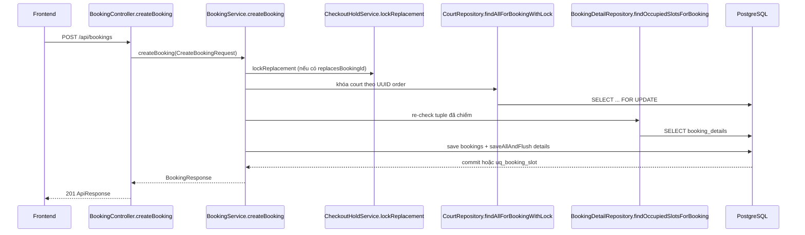
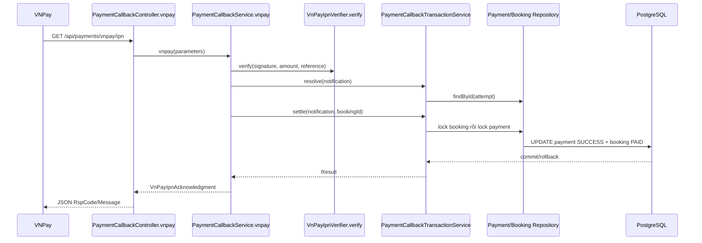
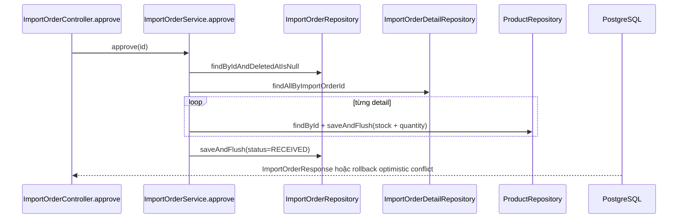

> Historical review before the 2026-11-05 payment cleanup. Current contract: CUSTOMER VNPAY; POS/Checkout CASH or VNPAY. Old transfer implementation descriptions below are historical and are no longer implemented. See docs/admin-customers-invoices.md for current verification.

# Backend Review — Badminton Court Management System

## Mục lục

1. [Tổng quan](#1-tổng-quan-backend)
2. [Cấu trúc folder](#2-cấu-trúc-folder-thực-tế)
3. [Nghiệp vụ đã triển khai](#3-các-nghiệp-vụ-đã-được-implement)
4. [CRUD chi tiết](#4-review-crud)
5. [Bảng CRUD tổng hợp](#5-bảng-tổng-hợp-crud)
6. [Logic nghiệp vụ đặc biệt](#6-logic-nghiệp-vụ-đặc-biệt)
7. [Entity, DTO, Repository và Database](#7-review-entity-dto-repository-và-database)
8. [Security, validation, transaction và exception](#8-security-validation-transaction-và-exception)
9. [Sơ đồ sequence](#9-sơ-đồ-luồng-gọi-hàm)
10. [Tổng kết](#10-tổng-kết)

## 1. Tổng quan backend

### 1.1 Công nghệ và kiến trúc

- Java 17, Spring Boot 3.2.5, Maven (xem `backend/pom.xml`).
- `spring-boot-starter-web` cung cấp REST MVC; `spring-boot-starter-validation` chạy Bean Validation; Springdoc tạo OpenAPI/Swagger.
- `spring-boot-starter-data-jpa` dùng Hibernate/JPA để map entity và sinh truy vấn từ tên method hoặc `@Query`.
- PostgreSQL là database runtime (`org.postgresql.Driver`, `application.yml`). H2 chỉ là runtime dependency phụ trợ.
- JWT dùng JJWT 0.12.5; BCrypt dùng để băm mật khẩu.
- Kiến trúc phân lớp thực tế: `controller` → `service` → `repository` → entity/JPA → PostgreSQL. `dto` là biên HTTP; `config`, `security`, `exception` là hạ tầng ngang.

`application.yml` đặt context path `/api`, `ddl-auto: validate`, `spring.sql.init.mode: never`, `open-in-view: false`. Vì vậy các bảng phải tồn tại theo `db/migration.sql`; service map dữ liệu lazy trước khi transaction kết thúc.

### 1.2 Luồng request tổng quát

```text
HTTP /api/... → Controller (@Valid, @RequestParam, @PathVariable)
→ Service (@Transactional, kiểm tra nghiệp vụ/ownership)
→ Repository (Spring Data/JPA/@Query/JdbcTemplate)
→ PostgreSQL (FK, CHECK, UNIQUE, index, lock)
→ Entity/DTO response → ApiResponse<T> hoặc provider acknowledgement
```

Ví dụ tạo booking: `BookingController.createBooking()` gọi `BookingService.createBooking()`, service khóa court bằng `CourtRepository.findAllForBookingWithLock()`, đọc customer/time slot, tạo `Booking`/`BookingDetail`, gọi `save()` và `saveAllAndFlush()`, rồi trả `BookingResponse` trong `ApiResponse`.

### 1.3 Response và lỗi

`com.bcm.dto.response.ApiResponse<T>` là envelope thành công/lỗi của web API. `GlobalExceptionHandler` map `BadRequestException` → 400, `ResourceNotFoundException` → 404, `DuplicateResourceException`/constraint DB → 409, `AccessDeniedException` → 403, authentication → 401 và lỗi còn lại → 500. VNPay IPN dùng `VnPayIpnAcknowledgment` (`RspCode`, `Message`) theo contract gateway, không bọc `ApiResponse`.

## 2. Cấu trúc folder thực tế

### 2.1 Cây source có liên quan

```text
backend/
├─ pom.xml
├─ src/main/java/com/bcm/
│  ├─ BadmintonCourtManagementApplication.java
│  ├─ config/       (SecurityConfig, SwaggerConfig, CorsConfig, DataSeeder, booking config)
│  ├─ controller/   (REST endpoints)
│  ├─ dto/request/  (request DTO và validation)
│  ├─ dto/response/ (ApiResponse và response DTO)
│  ├─ entity/       (JPA entity, enum, BaseEntity)
│  ├─ exception/    (custom exception, GlobalExceptionHandler)
│  ├─ repository/   (Spring Data repository và native/JPQL query)
│  ├─ security/     (JWT filter, principal, current customer)
│  ├─ service/      (transaction boundary và nghiệp vụ)
│  └─ util/         (JwtUtil)
└─ src/main/resources/
   ├─ application.yml
   ├─ application-local.yml
   └─ application-h2.yml
```

### 2.2 Folder và class

| Folder | Class/file chính | Vai trò và liên kết |
|---|---|---|
| `config` | `SecurityConfig`, `SwaggerConfig`, `CorsConfig`, `DataSeeder`, `BookingExpirationConfig`, `BookingPaymentConfig` | Tạo filter chain/JWT, CORS/OpenAPI, seed/reference, clock/scheduler và bind cấu hình booking/payment. |
| `controller` | `AuthController`, `BookingController`, `AvailabilityController`, `PaymentAttemptController`, `PaymentCallbackController`, `VnPayReturnController`, `CheckoutController`, `BookingPromotionController`, `PublicCatalogController`, `CourtController`, `TimeSlotController`, `CategoryController`, `ProductController`, `SupplierController`, `ImportOrderController`, `PosController`, `AnalyticsController`, `UserController`, `HealthController` | Nhận HTTP, bind DTO, gọi service và trả `ApiResponse`. Controller không trực tiếp tính giá/lưu DB, ngoại lệ là `PosController.getCustomers()` đọc `CustomerRepository` để phục vụ POS. |
| `service` | `BookingService`, `BookingHistoryService`, `BookingModificationService`, `BookingExpirationService`, `BookingExpirationJob`, `AvailabilityService`, `PaymentAttemptService`, `PaymentInitiationService`, `PaymentCallbackService`, `PaymentCallbackTransactionService`, `VnPayGateway`, `VnPayIpnVerifier`, `VnPaySigner`, `BookingPromotionService`, `CheckoutHoldService`, `CheckoutService` | Nghiệp vụ Booking Engine, transaction, lock, pricing, payment, callback, expiration và mapping response. |
| `service` | `AuthService`, `UserService`, `MasterDataService`, `BranchService`, `SupplierService`, `ImportOrderService`, `PosService`, `AnalyticsService` | Auth, CRUD master data, inventory/import, POS và báo cáo doanh thu đã có endpoint. |
| `repository` | `BookingRepository`, `BookingDetailRepository`, `CourtRepository`, `TimeSlotRepository`, `CustomerRepository`, `PaymentTransactionRepository`, `InvoiceRepository`, `InvoiceDetailRepository`, `UserRepository`, `RoleRepository`, `BranchRepository`, `CategoryRepository`, `ProductRepository`, `SupplierRepository`, `ImportOrderRepository`, `ImportOrderDetailRepository` | Repository JPA; các method `@Query`, `@Modifying`, `@Lock` cung cấp projection, pagination, lock và bulk update/delete. |
| `entity` | `Booking`, `BookingDetail`, `PaymentTransaction`, `Court`, `TimeSlot`, `Customer`, `Invoice`, `InvoiceDetail`, `Product`, `Category`, `Supplier`, `ImportOrder`, `ImportOrderDetail`, `User`, `Role`, `Branch`, `Staff` và enum | Map bảng migration; `BaseEntity` chứa audit/soft-delete cho entity có các cột tương ứng. `Product` có `@Version`. |
| `dto/request` | `CreateBookingRequest`, `UpdateBookingRequest`, `UpdateBookingContactRequest`, `CreatePaymentAttemptRequest`, `BookingPromotionRequest`, `CourtRequest`, `TimeSlotRequest`, `CategoryRequest`, `ProductRequest`, `RegisterRequest`, `LoginRequest`, `RefreshTokenRequest`, `SupplierRequest`, `ImportOrderRequest`, `PosSaleRequest`, `CheckoutRequest` | Contract input và Bean Validation. |
| `dto/response` | Booking history/detail/summary/contact, availability, payment attempt, checkout, import order, revenue, login, branch, `ApiResponse`, `VnPayIpnAcknowledgment` | Không trả entity lazy trực tiếp ở Booking/payment; service tạo response DTO. Một số CRUD admin trả entity. |
| `security` | `JwtAuthenticationFilter`, `CustomUserDetailsService`, `UserPrincipal`, `CurrentCustomerService` | Xác thực bearer JWT, nạp user/role và resolve `users.id` → `customers.id` cho ownership. |
| `exception` | `GlobalExceptionHandler`, `BadRequestException`, `ResourceNotFoundException`, `DuplicateResourceException`, payment exceptions | Chuyển lỗi service/DB thành HTTP envelope nhất quán. |
| `util` | `JwtUtil` | Tạo/kiểm tra access và refresh JWT. |

Các method quan trọng tập trung ở `BookingService.createBooking`, `AvailabilityService.getAvailability`, `BookingHistoryService.history/detail`, `BookingModificationService.updateDetails/updateContact`, `BookingExpirationService.expireBooking`, `PaymentAttemptService.createOrReuseAttempt`, `PaymentCallbackTransactionService.resolve/settle`, `MasterDataService.save*/delete*`, `AuthService.register/login/refreshToken`, `ImportOrderService.create/update/approve`, `PosService.sell` và `AnalyticsService.getRevenue`.

## 3. Các nghiệp vụ đã được implement

| Nghiệp vụ | Chức năng đã có | Controller chính |
|---|---|---|
| Authentication/JWT | đăng ký CUSTOMER, login, refresh token, `/me` | `AuthController`, `UserController` |
| Master data | CRUD court/time slot/category/product; quote giá; catalog branch | `CourtController`, `TimeSlotController`, `CategoryController`, `ProductController`, `PublicCatalogController` |
| Availability | grid court–slot theo ngày, lọc court | `AvailabilityController` |
| Booking | tạo PENDING, snapshot giá, deadline, history list/detail, contact/details update | `BookingController` |
| Booking lifecycle | expiration scheduler, release details, checkout hold leave/resume | `BookingExpirationJob`, `BookingController` |
| Promotion | automatic discount, preview/apply voucher, payment revalidation | `BookingPromotionController` |
| Payment | payment attempt VNPAY/BANK_TRANSFER policy, VNPay URL, IPN verify/settle, browser return | payment controllers |
| Checkout/invoice | gom booking fee + POS DRAFT, tạo invoice PAID, hoàn tất booking | `CheckoutController` |
| Supplier/import | supplier CRUD, import order CRUD/approve, tăng tồn kho | `SupplierController`, `ImportOrderController` |
| POS | bán hàng, trừ GOODS stock, tạo invoice/đổi detail | `PosController` |
| Analytics | doanh thu DAY/WEEK/MONTH | `AnalyticsController` |

### 3.1 API inventory (tên thật trong controller)

| Method | Endpoint (sau context `/api`) | Controller method | Service method |
|---|---|---|---|
| POST | `/auth/register` | `AuthController.register` | `AuthService.register` |
| POST | `/auth/login` | `AuthController.login` | `AuthService.login` |
| POST | `/auth/refresh` | `AuthController.refreshToken` | `AuthService.refreshToken` |
| GET | `/bookings/customer-profile` | `BookingController.customerProfile` | `CurrentCustomerService.requireCustomerId` |
| GET | `/bookings` | `BookingController.history` | `BookingHistoryService.history` |
| GET | `/bookings/{bookingId}` | `BookingController.detail` | `BookingHistoryService.detail` |
| POST | `/bookings` | `BookingController.createBooking` | `BookingService.createBooking` |
| GET/PATCH | `/bookings/{bookingId}/contact` | `BookingController.contact/updateContact` | `BookingModificationService.getContact/updateContact` |
| PATCH | `/bookings/{bookingId}/details` | `BookingController.updateDetails` | `BookingModificationService.updateDetails` |
| POST/GET | `/bookings/{bookingId}/checkout/leave`, `/checkout/hold`, `/checkout/resume`, `/checkout-clock` | `BookingController.leaveCheckout/replacementHold/resumeCheckout/checkoutClock` | `CheckoutHoldService.leave/replacementHold/resume`, `BookingHistoryService.detail` |
| POST | `/bookings/{bookingId}/payments` | `PaymentAttemptController.create` | `PaymentInitiationService.initiate` |
| POST | `/bookings/{bookingId}/promotion/preview` | `BookingPromotionController.preview` | `BookingPromotionService.quote(..., false)` |
| POST | `/bookings/{bookingId}/promotion/apply` | `BookingPromotionController.apply` | `BookingPromotionService.quote(..., true)` |
| DELETE | `/bookings/{bookingId}/promotion` | `BookingPromotionController.remove` | `BookingPromotionService.quote(..., null, true)` |
| GET | `/availability` | `AvailabilityController.getAvailability` | `AvailabilityService.getAvailability` |
| GET | `/public/availability`, `/public/booking-clock`, `/public/courts`, `/public/branches`, `/public/branches/{branchId}/courts`, `/public/time-slots`, `/public/categories`, `/public/products`, `/public/price-quote` | `PublicCatalogController` methods `availability/bookingClock/courts/branches/branchCourts/slots/categories/products/quote` | `AvailabilityService`, `MasterDataService`, `BranchService` |
| GET | `/payments/vnpay/ipn` | `PaymentCallbackController.vnpay` | `PaymentCallbackService.vnpay` |
| GET | `/payments/vnpay/return` | `VnPayReturnController.browserReturn` | `VnPayIpnVerifier.verify` |
| POST | `/checkout/{bookingId}` | `CheckoutController.checkout` | `CheckoutService.checkout` |
| CRUD | `/admin/courts`, `/admin/time-slots`, `/admin/categories`, `/admin/products` | `CourtController`, `TimeSlotController`, `CategoryController`, `ProductController` | `MasterDataService` methods |
| CRUD | `/suppliers` | `SupplierController.findAll/findById/create/update/delete` | same names in `SupplierService` |
| CRUD + POST approve | `/import-orders`, `/import-orders/{id}/approve` | `ImportOrderController` methods | `ImportOrderService` methods |
| GET/POST | `/pos/customers`, `/pos/sales` | `PosController.getCustomers/sell` | `CustomerRepository.findAll`, `PosService.sell` |
| GET | `/analytics/revenue` | `AnalyticsController.getRevenue` | `AnalyticsService.getRevenue` |

## 4. Review CRUD

### 4.1 Booking — CREATE

**API:** `POST /api/bookings` → `BookingController.createBooking(@Valid CreateBookingRequest)` → HTTP 201, `ApiResponse<BookingResponse>`. Endpoint yêu cầu JWT CUSTOMER; `customerId` phải bằng ID được `CurrentCustomerService.requireCustomerId()` resolve từ principal.

`CreateBookingRequest` gồm `customerId`, tùy chọn `branchId`, `replacesBookingId` và `details[]` (`bookingDate`, `courtId`, `timeSlotId`). Unknown JSON fields không thay được status/giá/expiry.

**Trình tự `BookingService.createBooking`:**

1. Null/Bean Validation; lỗi → `BadRequestException` 400.
2. Resolve customer tin cậy và so khớp `request.customerId`; sai → 403.
3. Dùng `HashSet<SlotKey>` phát hiện tuple trùng trong request.
4. Nếu có `replacesBookingId`, gọi `CheckoutHoldService.lockReplacement` để khóa và kiểm tra hold cũ; không tự giải phóng hold.
5. Lấy court IDs, sort theo UUID, gọi `CourtRepository.findAllForBookingWithLock` (`PESSIMISTIC_WRITE`). Kiểm tra branch active và court cùng branch.
6. `CustomerRepository.findById`, `TimeSlotRepository.findByIdInAndDeletedAtIsNull`; thiếu reference → 404.
7. Với từng detail: court phải `AVAILABLE`/chưa soft-delete; slot phải tồn tại; start time phải tương lai theo `Asia/Ho_Chi_Minh`; giá = `basePrice × priceMultiplier`, `HALF_UP` scale 2; tạo `BookingDetail` snapshot.
8. Cộng tổng, kiểm tra precision NUMERIC(10,2), gọi `BookingPromotionService.automatic(booking)` để đặt discount tự động, đặt `PENDING` và `expiresAt = now + booking.hold-duration`.
9. `BookingDetailRepository.findOccupiedSlotsForBooking` re-check sau lock. Tuple đã tồn tại → `DuplicateResourceException` 409.
10. `BookingRepository.save(booking)` ghi header; `details.saveAllAndFlush(bookingDetails)` ghi details và ép kiểm tra `uq_booking_slot`. Lỗi flush/commit rollback cả header và details.

Code thực tế cốt lõi:

```java
booking.setStatus(BookingStatus.PENDING);
BigDecimal price = court.getBasePrice().multiply(slot.getPriceMultiplier())
        .setScale(2, RoundingMode.HALF_UP);
booking.setCourtFee(total);
BookingPromotionService.automatic(booking);
booking.setExpiresAt(LocalDateTime.now(clock).plus(holdDuration));
bookings.save(booking);
details.saveAllAndFlush(bookingDetails);
```

### 4.2 Booking — READ LIST

`GET /api/bookings?customerId=&status=&page=0&size=20` → `BookingController.history` → `BookingHistoryService.history` → `BookingRepository.findHistory`. Service giới hạn `page >= 0`, `1 <= size <= 100`, buộc ownership và dùng `PageRequest`; query lọc customer/status, sort `created_at DESC, id DESC`, trả `BookingHistoryResponse`. List chỉ đọc header/summary; không load details/payments và không expire booking.

### 4.3 Booking — READ DETAIL

`GET /api/bookings/{bookingId}` → `BookingHistoryService.detail`. Service `findById`, kiểm tra customer sở hữu, lấy `findHistoryDetails`, branch hiện tại bằng `BranchRepository.findAllById`, payment bằng `PaymentTransactionRepository.findBookingHistory`, map sang `BookingHistoryDetailResponse`. Booking `EXPIRED` vẫn trả header/courtFee/payment history nhưng details rỗng vì expiration đã xóa details; không tái dựng slot.

### 4.4 Booking — UPDATE contact/details

- `GET/PATCH /api/bookings/{id}/contact` → `BookingModificationService.getContact/updateContact`. Ownership được resolve server-side; request chỉ cho `fullName` 2–255 và phone 10–20 chữ số. Update khóa booking, chỉ đổi contact snapshot; yêu cầu `PENDING`, chưa hết hạn và chưa có payment attempt.
- `PATCH /api/bookings/{id}/details` → `BookingModificationService.updateDetails`. Chỉ booking pending, single-court, chưa có payment và deadline còn hiệu lực; khóa booking rồi court; tuple mới được kiểm tra unique/occupied, tuple giữ nguyên dùng giá snapshot cũ, tuple mới tính giá master `HALF_UP`; xóa details cũ và lưu details mới atomic, cập nhật fee/discount nhưng giữ deadline/identity.

### 4.5 Booking — DELETE

Không có endpoint delete booking. Release không phải xóa header: `BookingExpirationService.expireBooking` khóa booking, re-check deadline/status, `updateExpirationStatus(...EXPIRED)` rồi `deleteAllForExpiredBooking` trong cùng transaction. Header và payment history giữ lại; chỉ details bị xóa để giải phóng unique slot.

### 4.6 Master data CRUD

Các controller admin dùng chung `MasterDataService`:

| Tài nguyên | List/detail | Create/update | Delete |
|---|---|---|---|
| Court | `GET /api/admin/courts`, `GET /{id}` → `courts()`, `court()` | `POST/PUT` → `saveCourt(null/id, CourtRequest)`; kiểm tra số sân trùng, district/address, status, base price | `deleteCourt`: soft-delete, chặn nếu còn booking active |
| Time slot | `slots()`, `slot()` | `saveSlot`: start < end, phút nguyên, không overlap; tự suy peak 1.50/1.00 khi multiplier null; không đổi khung đã được tham chiếu | `deleteSlot`: soft-delete, chặn nếu booking detail tham chiếu |
| Category | `categories()`, `category()` | `saveCategory`: tên trim, không trùng ignore-case | `deleteCategory`: soft-delete, chặn nếu còn product |
| Product | `products()`, `product()` | `saveProduct`: category tồn tại; SERVICE stock phải 0; update yêu cầu version đúng và không sửa stock trực tiếp | `deleteProduct`: soft-delete |

Các `save*` gọi `saveAndFlush`; read dùng repository `...DeletedAtIsNull...`; delete không xóa vật lý. `Product` dùng `@Version`, lỗi optimistic được handler trả 409.

### 4.7 Supplier CRUD

`SupplierController` (`/api/suppliers`, ADMIN) gọi `SupplierService.findAll/findById/create/update/delete`. Create builder từ `SupplierRequest`, update lấy active entity rồi set name/phone/address, delete gọi `softDelete`; repository tương ứng `findAllByDeletedAtIsNullOrderByNameAsc` và `save`. Missing supplier → 404.

### 4.8 Import order CRUD và approve

`ImportOrderController` (`/api/import-orders`, ADMIN):

- `GET` list/detail → `findAll/findById`, map `ImportOrderResponse` kèm `ImportOrderDetailRepository.findAllByImportOrderId`.
- `POST` → `create`: `requireSupplier`, status `DRAFT`, `calculateTotal(price × quantity)`, save header rồi `saveDetails`.
- `PUT` → `update`: `getOrder`, `ensureEditable` (DRAFT/CONFIRMED), cập nhật header, xóa detail cũ và ghi detail mới.
- `DELETE` → `delete`: không delete vật lý; chuyển `CANCELLED`.
- `POST /{id}/approve` → `approve`: yêu cầu có detail, đọc từng Product, cộng stock, `saveAndFlush`; bắt optimistic conflict thành 400; sau cùng chuyển order `RECEIVED`. Toàn bộ transaction rollback nếu sản phẩm hoặc order lỗi.

### 4.9 POS create sale

`POST /api/pos/sales` → `PosService.sell(PosSaleRequest)`. `aggregateQuantities` gom product trùng; mỗi product đọc bằng `ProductRepository.findById`, GOODS kiểm tra tồn và trừ stock (`@Version` bảo vệ cạnh tranh), SERVICE không trừ kho; tính product fee, normalize CASH/QR/BANK_TRANSFER/VNPAY, resolve customer, tạo `Invoice` (booking null → PAID, có booking → DRAFT), save invoice rồi gắn/save `InvoiceDetail`. Optimistic failure → 400 thiếu kho.

### 4.10 Checkout invoice

`POST /api/checkout/{bookingId}` → `CheckoutService.checkout`. Khóa booking (`findByIdForExpiration`), normalize payment method, cấm CASH cho booking; chỉ PAID/CHECKED_IN, không có bank transfer `CUSTOMER_DECLARED` chưa reconcile. Lấy `sumProductFeeByBookingIdAndStatus` và `sumDiscountAmountByBookingIdAndStatus` của invoice DRAFT, cộng court fee/trừ discount, tạo invoice PAID, chuyển detail từ POS invoice sang invoice mới, hủy DRAFT cũ, set booking COMPLETED và trả `CheckoutResponse`.

## 5. Bảng tổng hợp CRUD

| Nghiệp vụ | Chức năng | Endpoint | Controller method | Service method | Repository method chính | Bảng |
|---|---|---|---|---|---|---|
| Booking | Create | POST `/bookings` | `BookingController.createBooking` | `BookingService.createBooking` | `findAllForBookingWithLock`, `findOccupiedSlotsForBooking`, `save`, `saveAllAndFlush` | `bookings`, `booking_details` |
| Booking | List | GET `/bookings` | `BookingController.history` | `BookingHistoryService.history` | `findHistory` | `bookings` |
| Booking | Detail | GET `/bookings/{id}` | `BookingController.detail` | `BookingHistoryService.detail` | `findById`, `findHistoryDetails`, `findBookingHistory` | bookings/details/payments |
| Court | CRUD | `/admin/courts` | `CourtController.list/get/create/update/delete` | `MasterDataService.courts/court/saveCourt/deleteCourt` | derived `find...`, `saveAndFlush` | `courts` |
| Time slot | CRUD | `/admin/time-slots` | tương ứng | `slots/slot/saveSlot/deleteSlot` | `overlaps`, `saveAndFlush` | `time_slots` |
| Category | CRUD | `/admin/categories` | tương ứng | `categories/category/saveCategory/deleteCategory` | duplicate query, `saveAndFlush` | `categories` |
| Product | CRUD | `/admin/products` | tương ứng | `products/product/saveProduct/deleteProduct` | active queries, `saveAndFlush` | `products` |
| Supplier | CRUD | `/suppliers` | `SupplierController.findAll/findById/create/update/delete` | cùng tên trong `SupplierService` | active queries, `save` | `suppliers` |
| Import order | CRUD/approve | `/import-orders` | `findAll/findById/create/update/delete/approve` | cùng tên trong `ImportOrderService` | order/detail/product repository methods | `import_orders`, details, products |
| POS | Create sale | POST `/pos/sales` | `PosController.sell` | `PosService.sell` | product/invoice/detail save | invoices, invoice_details, products |

## 6. Logic nghiệp vụ đặc biệt

### 6.1 Availability và chống trùng lịch

`AvailabilityService.getAvailability` thực hiện tối đa ba truy vấn: court AVAILABLE chưa xóa, time-slot template, và projection occupied từ `BookingDetailRepository.findOccupiedSlots`. Slot quá khứ trả `PAST`; detail tồn tại luôn chiếm chỗ kể cả header EXPIRED. Tạo booking khóa toàn bộ court theo UUID order bằng `findAllForBookingWithLock`, re-check occupied sau khóa và để `uq_booking_slot(booking_date,court_id,time_slot_id)` là hàng rào cuối. Unique violation được `GlobalExceptionHandler` trả 409.

### 6.2 Expiration/release

`BookingExpirationJob.expireDueBookings` lấy candidate từ `findExpirationCandidates(PENDING, now)` rồi gọi service qua Spring proxy. `expireBooking` khóa booking, kiểm tra lại PENDING và `expiresAt <= clock`, update status EXPIRED và bulk delete details cùng transaction. `CheckoutHoldService.leave/resume` chỉ đặt/xóa `checkoutReleaseAt`; `resume` gọi expiration nếu deadline đã đến. Payment PENDING/SUCCESS bảo vệ hold.

### 6.3 Promotion

`BookingPromotionService.automaticDiscount` giảm 30.000 khi subtotal ≥ 300.000 và 50.000 khi ≥ 500.000. `quote` khóa booking, ownership, editable/deadline và không cho apply sau payment attempt. `calculate` truy vấn promotion/rule bằng `JdbcTemplate`, kiểm tra NEWMEMBER/KMKH10 trong `eligibility`, giới hạn discount không vượt subtotal. `validatePayment` tính lại voucher dưới booking lock trước khi tạo payment.

### 6.4 Payment và VNPay callback

`PaymentAttemptService.createOrReuseAttempt` kiểm tra request/method, lock booking, ownership, deadline, amount từ `booking.finalAmount`, reuse pending attempt và ghi `PaymentTransaction` PENDING. BANK_TRANSFER có thể ghi note `CUSTOMER_DECLARED` và chuyển booking PAID theo policy hiện tại; tiền vẫn chưa được xác minh.

`PaymentInitiationService.initiate` dùng `Propagation.NEVER`: tạo/reuse attempt trong transaction ngắn, recheck sau commit, gọi `VnPayGateway.initiate` ngoài DB lock, rồi recheck lần cuối.

`PaymentCallbackService.vnpay` gọi `VnPayIpnVerifier.verify` (checksum/HMAC, merchant reference, amount), sau đó `resolve` đọc payment và `settle` khóa Booking trước Payment. `settle` kiểm tra target/method/amount, trạng thái PENDING, deadline, transaction metadata; hợp lệ thì set payment SUCCESS + transaction fields và booking PAID atomically. Callback lặp trả `ALREADY_CONFIRMED`; callback muộn ghi `RECONCILIATION_REQUIRED` và không hồi sinh booking. Unique `uq_transaction_id` được nhận diện thành `TRANSACTION_ID_CONFLICT`; chưa acknowledge success trước commit.

`VnPayReturnController.browserReturn` chỉ verify/hiển thị kết quả redirect, không settle và không dùng redirect làm bằng chứng thanh toán.

### 6.5 Authentication và ownership

`AuthService.register` kiểm tra email, lấy role CUSTOMER, BCrypt password, save User rồi Customer trong một transaction và phát access/refresh token. `login` dùng `AuthenticationManager`, đọc user active và phát token. `refreshToken` validate chữ ký/purpose refresh rồi đọc user active và phát cặp mới. `CurrentCustomerService` dùng principal `users.id` để query active `customers.id`; history/detail/create booking không tin UUID customer do client gửi nếu không khớp.

### 6.6 Analytics

`AnalyticsService.getRevenue` normalize DAY/WEEK/MONTH, tạo date range, gọi `InvoiceRepository.sumRevenueByPeriod('PAID', from, toExclusive)` và map null aggregate thành zero. Controller giới hạn ADMIN.

## 7. Review Entity, DTO, Repository và Database

### 7.1 Entity và quan hệ

| Entity | Table | Mapping/field chính |
|---|---|---|
| `Booking` | `bookings` | UUID, customer LAZY, status, courtFee, discount/final amount, expires/release timestamps, audit staff. Không kế thừa `BaseEntity` nếu schema không đủ cột. |
| `BookingDetail` | `booking_details` | booking/court/timeSlot LAZY, bookingDate, snapshot price. |
| `PaymentTransaction` | `payment_transactions` | XOR booking/invoice, method/status, amount, gateway transaction/date/note. |
| `Court` | `courts` | branch metadata, code/number/name/type/status/basePrice, soft delete. |
| `TimeSlot` | `time_slots` | start/end, priceMultiplier, soft delete. |
| `Customer`/`User`/`Role` | `customers`/`users`/`roles` | Customer tham chiếu User; User roles many-to-many; BaseEntity soft delete cho bảng phù hợp. |
| `Product` | `products` | categoryId, type, price, stockQuantity, `@Version`, soft delete. |
| `Invoice`/`InvoiceDetail` | `invoices`/`invoice_details` | booking/customer/payment/status/fees; line product quantity/unit price. |
| `ImportOrder`/`ImportOrderDetail` | `import_orders`/`import_order_details` | supplier/status/total/date; product quantity/import price. |

Các FK và CHECK quan trọng theo `db/migration.sql`: `chk_pending_expires`, `chk_payment_target`, status enums, `uq_booking_slot`, `uq_transaction_id`, product stock ≥ 0, time start < end. Tiền map `BigDecimal` precision/scale 10,2.

### 7.2 DTO và validation

Request booking/payment dùng `@Valid`, nested details dùng `@Valid`; các master DTO dùng `@NotNull`, `@NotBlank`, `@Size`, `@Digits`, `@DecimalMin`, `@Positive`. `UpdateBookingContactRequest` giới hạn fullName/phone; `ProductRequest` yêu cầu version khi update qua service; `CreatePaymentAttemptRequest.BankTransfer` kiểm tra bank fields/regex. Response booking/history/payment/availability là record/class DTO, tránh expose lazy entity. Một số admin CRUD trả entity trực tiếp theo code controller.

### 7.3 Repository được service sử dụng

- `BookingRepository`: `findHistory`, `findExpirationCandidates`, `findByIdForExpiration` (`PESSIMISTIC_WRITE`), `updateExpirationStatus`.
- `BookingDetailRepository`: occupied projections, conflict replacement, history details, `deleteForReplacement`, `deleteAllForExpiredBooking`.
- `CourtRepository`: availability query, `findAllForBookingWithLock`, branch active và active court queries.
- `TimeSlotRepository`: active ordered list, `findByIdIn...`, overlap query.
- `PaymentTransactionRepository`: booking history, pending/success existence, initiation lookup, callback lock lookup.
- `InvoiceRepository`: booking POS fee/discount sums, revenue aggregate, pending invoice lookup.
- `InvoiceDetailRepository`: find by invoice/invoice IDs, delete/import detail transfer.
- `CustomerRepository`, `UserRepository`, `RoleRepository`: identity/reference and registration.
- `ProductRepository`: active catalog, category reference, versioned stock writes.
- Supplier/import/category repositories: active list, status filtering, details and soft-delete.

### 7.4 Đối chiếu schema với source

`db/migration.sql` hiện có các bảng booking/payment/invoice/master data cơ bản và các constraint `uq_booking_slot`, `uq_transaction_id`. Tuy nhiên source hiện tại map thêm một số cột/bảng như `bookings.contact_full_name`, `contact_phone`, `discount_amount`, `promotion_code`, `requested_voucher`, `checkout_release_at`, `courts.branch_id`, `court_code`, `district`, `address` và entity `Branch` (`branches`). Các tên này không xuất hiện trong migration đang có trong working tree. Vì `application.yml` đặt `ddl-auto: validate`, đây là khác biệt schema–mapping cần được xem là một điều kiện triển khai: phần mô tả service phản ánh code đã viết, còn tính “hoàn chỉnh khi chạy PostgreSQL từ migration hiện tại” không thể khẳng định cho các field/bảng chênh lệch này. Không có migration mới hoặc sửa schema nào được thực hiện trong review.

## 8. Security, validation, transaction và exception

| Thành phần | Method/class | Logic thực tế |
|---|---|---|
| JWT filter | `JwtAuthenticationFilter.doFilterInternal` | Đọc Bearer token, validate bằng `JwtUtil`, nạp `UserDetails`, đặt `SecurityContext`. |
| Principal | `UserPrincipal.create` | Mang user UUID/email/roles cho Spring Security. |
| Password | `SecurityConfig.passwordEncoder` | BCrypt; `AuthService.register` encode, login xác thực qua `DaoAuthenticationProvider`. |
| Authorization | `SecurityConfig.securityFilterChain`, `@PreAuthorize` trên Supplier/Import/POS/Analytics | Stateless session; `/auth`, `/public`, health, Swagger và provider callback public; admin/staff và các route còn lại yêu cầu role/JWT. |
| Ownership | `CurrentCustomerService.requireCustomerId` | Principal user ID → active customer ID; booking history/detail/payment/create kiểm tra sở hữu. |
| Validation | `@Valid` tại controller, `Validator` trong booking | DTO constraint trả 400; service kiểm tra deadline, state, duplicate tuple, money precision. |
| Transaction | `@Transactional` service methods | Header/details, expiration delete, payment SUCCESS+PAID, POS stock/invoice, import approve đều atomic; read history `readOnly`, `REPEATABLE_READ`. |
| Pessimistic lock | `CourtRepository.findAllForBookingWithLock`, `BookingRepository.findByIdForExpiration`, payment callback | Khóa court/booking theo thứ tự cố định; unique index bảo vệ slot còn lại. |
| Optimistic lock | `Product.version` | POS/import stock update conflict → 400/409 handler. |
| Exception | `GlobalExceptionHandler` | Chuẩn hóa 400/401/403/404/409/500 thành `ApiResponse`; constraint `uq_booking_slot` có thông điệp slot đã đặt. |

## 9. Sơ đồ luồng gọi hàm

### 9.1 Tạo booking



### 9.2 VNPay callback



### 9.3 Import approve/stock



## 10. Tổng kết

### 10.1 Nghiệp vụ và method chính

| Nghiệp vụ | Class | Method tiêu biểu |
|---|---|---|
| Booking | `BookingService` | `createBooking` |
| Availability | `AvailabilityService` | `getAvailability` |
| History | `BookingHistoryService` | `history`, `detail` |
| Modification | `BookingModificationService` | `updateContact`, `updateDetails` |
| Expiration | `BookingExpirationService`/`BookingExpirationJob` | `expireBooking`, `expireDueBookings` |
| Payment | `PaymentAttemptService`, `PaymentCallbackTransactionService` | `createOrReuseAttempt`, `resolve`, `settle` |
| Master data | `MasterDataService` | `saveCourt/saveSlot/saveCategory/saveProduct`, `delete*` |
| Auth | `AuthService` | `register`, `login`, `refreshToken` |
| Inventory | `ImportOrderService`, `PosService` | `create/update/approve`, `sell` |
| Checkout/report | `CheckoutService`, `AnalyticsService` | `checkout`, `getRevenue` |

### 10.2 Luồng đã hoàn thiện

1. JWT registration/login/refresh → authenticated role/ownership.
2. Availability read-only → court lock + unique slot → PENDING booking snapshot.
3. PENDING deadline → scheduler/hold resume → EXPIRED và xóa details atomic.
4. Payment attempt → provider URL ngoài lock → verified callback → SUCCESS payment + PAID booking.
5. Booking history/detail → ownership + repeatable-read snapshot → DTO hiện trạng.
6. Admin master-data CRUD, supplier/import, POS stock/invoice, paid checkout và revenue report.

### 10.3 Phạm vi dữ liệu và cách xóa

Court, time slot, category, product, supplier dùng soft delete qua `deleted_at`. Booking không có delete endpoint; expiration chỉ xóa `booking_details` và giữ header/payment history. Import order chuyển `CANCELLED`; invoice/payment được lưu để phục vụ lịch sử và đối soát.

