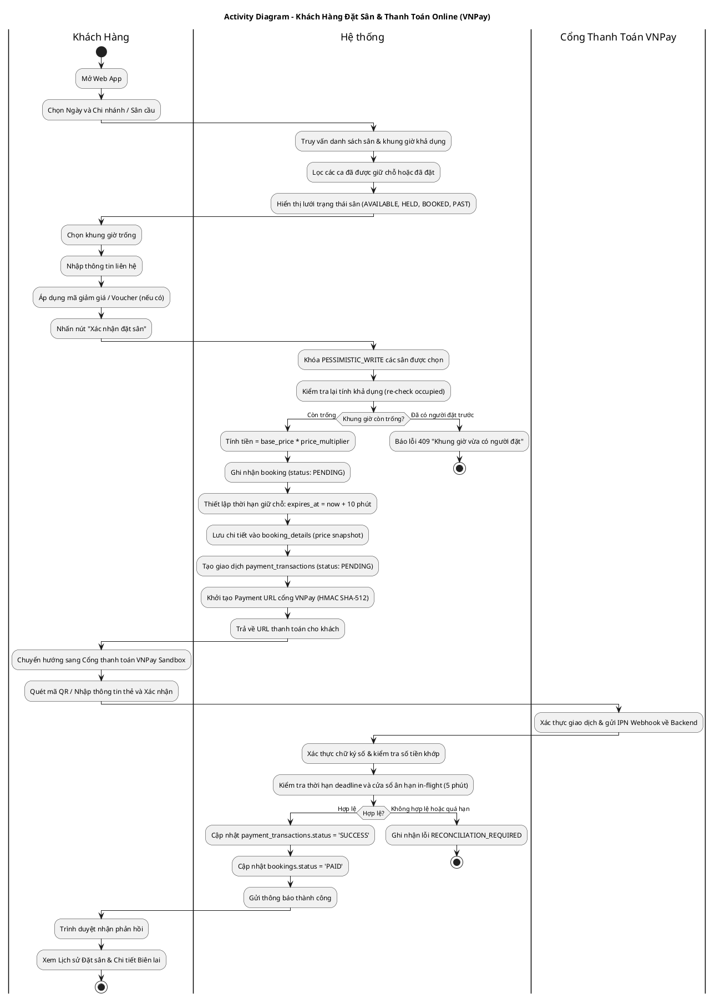
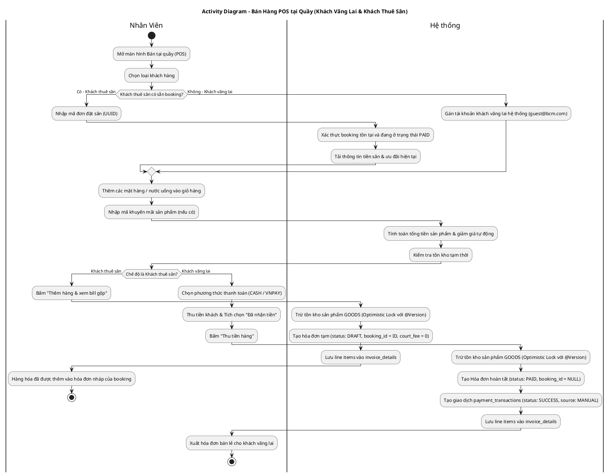
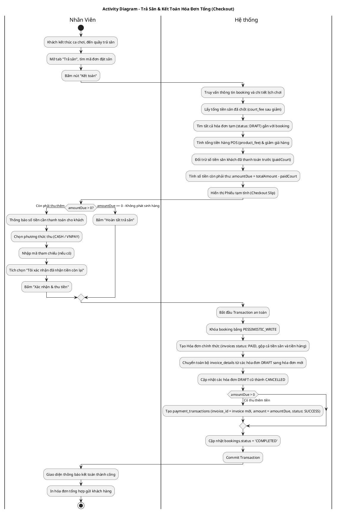
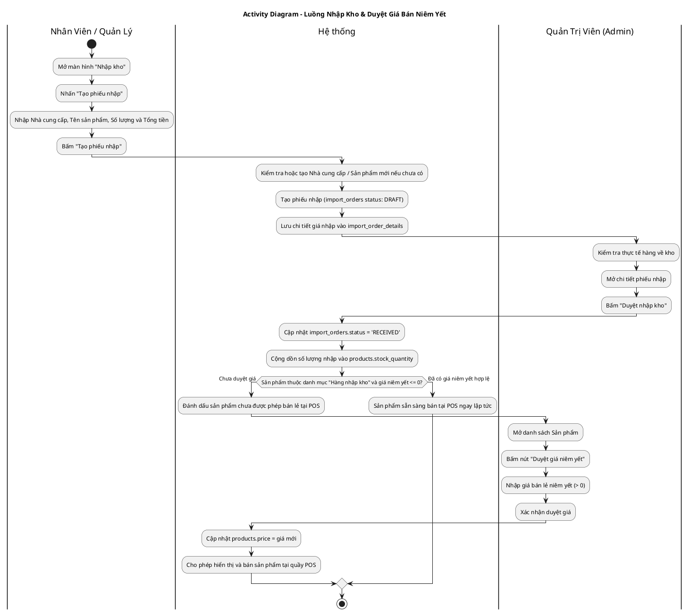

# Sơ đồ Activity (Hoạt động) - Hệ thống Quản lý Sân Cầu Lông (Bản Đồng Bộ V5)

Các sơ đồ Hoạt động mô phỏng luồng nghiệp vụ thực tế của người dùng và hệ thống, có điều kiện logic (if/else), đồng bộ 100% với backend Spring Boot và cơ sở dữ liệu PostgreSQL.

> **Hướng dẫn xem hình:** Copy từng đoạn mã PlantUML bên dưới và dán vào công cụ xem trực quan như **[PlantText](https://www.planttext.com/)** hoặc **[Mermaid Live Editor](https://mermaid.live/)**.

---

## 1. Luồng Tìm Kiếm, Đặt Sân & Thanh Toán Online (Khách Hàng)

---

## 2. Luồng Bán Hàng POS tại Quầy (Nhân Viên)

---

## 3. Luồng Trả Sân & Kết Toán Hóa Đơn Tổng (Checkout Flow)

---

## 4. Luồng Nhập Hàng Vào Kho & Duyệt Giá Bán (Admin / Staff)

