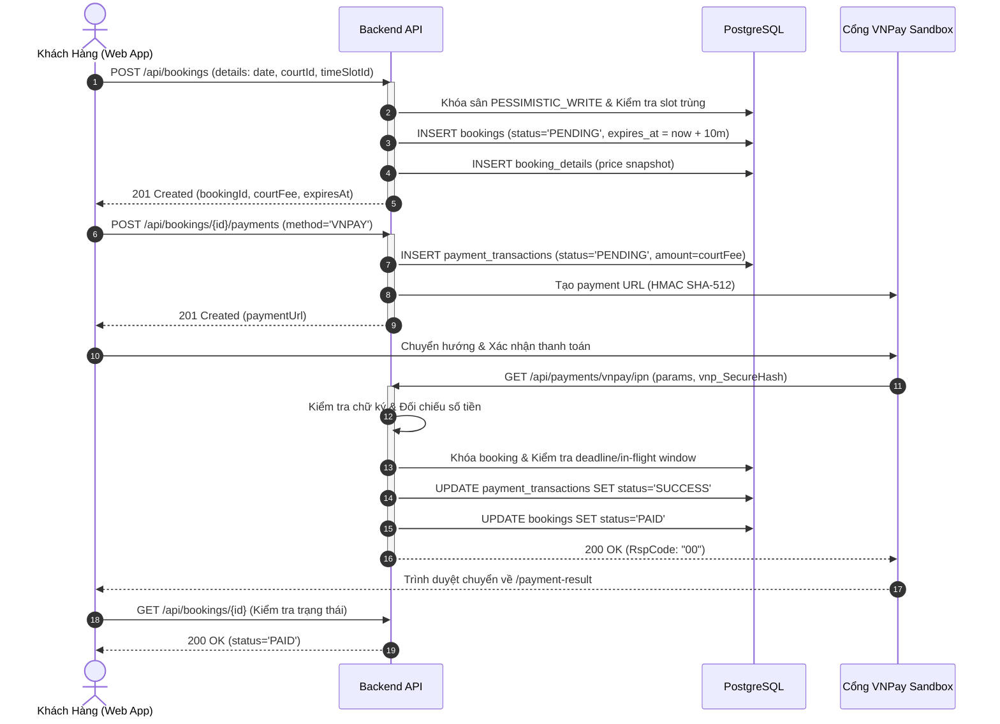
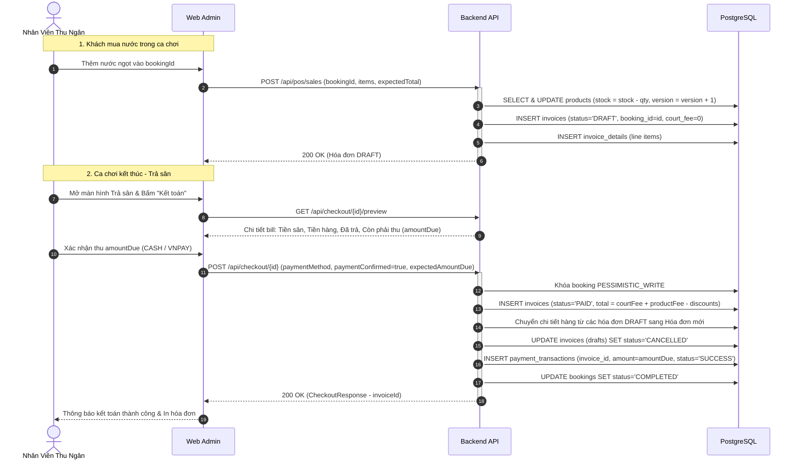

# Payment & Invoice Flow - Hệ thống Quản lý Sân Cầu Lông (Bản Đồng Bộ V5)

Tài liệu này là nguồn tài liệu chuẩn hóa toàn diện về luồng Thanh Toán (Payment), Bán hàng tại quầy (POS), Kết toán trả sân (Checkout) và Hạch toán hóa đơn (Invoice) trong hệ thống Badminton Court Management (BCM).

---

## 0. Các Chính Sách Nghiệp Vụ Cốt Lõi

### P0 — Cửa sổ ân hạn In-flight (Chống mất tiền khi VNPay phản hồi muộn)
Một booking có giao dịch `PENDING` (khách hàng đang tiến hành thanh toán trên cổng VNPay) **không bị hủy (EXPIRED)** khi chạm mốc 10 phút nếu thời gian hiện tại vẫn nằm trong cửa sổ `expires_at + inFlightGrace` (mặc định `PT5M` - 5 phút).
* **Cơ chế:** IPN Webhook từ VNPay gửi về trong cửa sổ này vẫn được chấp nhận và đối soát thành công $\rightarrow$ chuyển đơn sang `PAID`.
* **Mục đích:** Khắc phục triệt để rủi ro *"Khách bị ngân hàng trừ tiền nhưng hệ thống đã nhả sân cho người khác"*. Sau khi hết cửa sổ 5 phút mà không có IPN thành công, lượt thử đó được xem là hết hạn (stale) và sân được giải phóng bình thường.

### P1 — Chính sách Không Hoàn Tiền (No Cancellation / No Refund)
Sau khi booking đã thanh toán thành công (trạng thái `PAID` với giao dịch `SUCCESS`), hệ thống **không cung cấp tính năng hủy đơn hay hoàn tiền tự động**:
* Khách hàng không thể tự hủy đơn đặt sân đã thanh toán.
* Mọi trường hợp bất khả kháng phát sinh (khách không đến, thời tiết) đều được xử lý đối soát thủ công bởi chủ sân / quản trị viên.

### P2 — Giải phóng Slot khi Booking Quá Hạn (`EXPIRED`)
Khi một booking ở trạng thái `PENDING` quá hạn thanh toán:
* `BookingExpirationService.expireBooking` đổi trạng thái booking thành `EXPIRED`.
* Trong cùng một transaction, hệ thống thực hiện **xóa toàn bộ các dòng liên quan trong `booking_details`** để giải phóng ràng buộc duy nhất `uq_booking_slot(booking_date, court_id, time_slot_id)`.
* **Hệ quả:** Slot trống được mở lại ngay lập tức cho các khách hàng khác đặt. Bản ghi `bookings` header và lịch sử các lượt thử thanh toán (nếu có) vẫn được lưu giữ đầy đủ để phục vụ kiểm toán đối soát.

### P3 — Hai Phương Thức Thanh Toán Hợp Lệ (`CASH`, `VNPAY`)
* Hệ thống đã chuẩn hóa toàn bộ về 2 phương thức: **`CASH`** (Tiền mặt) và **`VNPAY`** (Cổng thanh toán VNPay).
* Khách hàng đặt sân online chỉ sử dụng `VNPAY`.
* Tại quầy thu ngân (POS bán hàng và Checkout trả sân), nhân viên có thể thu bằng `CASH` hoặc `VNPAY` (xác nhận thủ công).

### P4 — Ràng buộc Mục tiêu Thanh toán (XOR Constraint)
Bảng `payment_transactions` áp dụng ràng buộc nghiêm ngặt: Mỗi giao dịch thanh toán chỉ được phép thanh toán cho **HOẶC** Đơn đặt sân (`booking_id`), **HOẶC** Hóa đơn (`invoice_id`), tuyệt đối không được phép có cả hai hoặc không có cái nào:
```sql
CONSTRAINT chk_payment_target CHECK (
    (booking_id IS NOT NULL AND invoice_id IS NULL) OR
    (booking_id IS NULL AND invoice_id IS NOT NULL)
);
```

---

## 1. Tổng Quan Các Luồng Nghiệp Vụ

### 1.1. Luồng 1: Đặt Sân Online $\rightarrow$ Mua Hàng POS $\rightarrow$ Trả Sân Kết Toán (Checkout)
```text
[Khách Hàng]                                   [Nhân Viên Thu Ngân]
     │                                                   │
     ├─ 1. Chọn sân & giờ (POST /api/bookings)           │
     │     └─ status: PENDING (giữ slot 10 phút)         │
     │                                                   │
     ├─ 2. Thanh toán VNPay Sandbox                      │
     │     └─ IPN Callback: status -> PAID               │
     │                                                   │
     ▼                                                   ▼
[Đến Sân Chơi Cầu Lông]                                  │
     │                                                   │
     ├─ 3. Khách mua nước/cầu tại quầy ─────────────────►│ Thêm hàng POS vào bookingId
     │                                                   │   └─ Tạo Invoice DRAFT
     │                                                   │   └─ Trừ kho hàng GOODS
     ▼                                                   ▼
[Chơi Xong Ca Đặt] ─────────────────────────────────────►│ Bấm "Kết toán" (POST /api/checkout/{id})
                                                         │   ├─ Tiền sân: Đã trả trước
                                                         │   ├─ Tiền hàng: Thu thêm (CASH/VNPay)
                                                         │   ├─ Xuất 1 Hóa đơn duy nhất (PAID)
                                                         │   ├─ Hủy các hóa đơn DRAFT tạm
                                                         │   └─ Booking chuyển sang COMPLETED
```

### 1.2. Luồng 2: Khách Vãng Lai (Walk-in) Mua Hàng Lẻ Tại Quầy
* Khách đến quầy mua nước, phụ kiện (không gắn với lịch đặt sân).
* Nhân viên chọn hàng $\rightarrow$ Áp dụng khuyến mãi sản phẩm (nếu có) $\rightarrow$ Chọn phương thức `CASH` hoặc `VNPAY` $\rightarrow$ Xác nhận thu tiền (`POST /api/pos/sales`).
* Hệ thống tự động map với tài khoản khách vãng lai hệ thống (`guest@bcm.com`), trừ tồn kho và xuất hóa đơn `PAID` kèm bản ghi thanh toán ngay tại thời điểm bán.

### 1.3. Luồng 3: Khách Đặt Trước Thu Tiền Sân Tại Quầy
* Áp dụng khi khách đã tạo đơn đặt trước (đang `PENDING`) và muốn trả tiền mặt hoặc quét mã trực tiếp tại quầy thu ngân.
* Nhân viên xác nhận thu tiền (`POST /api/pos/bookings/{id}/receive`) với phương thức `CASH` hoặc `VNPAY`.
* Hệ thống ghi nhận biên lai thu tiền sân (`source = 'MANUAL'`), chuyển booking sang `PAID`, hủy bỏ bộ đếm timeout giữ chỗ.

### 1.4. Luồng 4: Hết Hạn Giữ Chỗ (Expiration)
* Đơn đặt sân `PENDING` nếu sau 10 phút khách không thanh toán và không có giao dịch in-flight đang chờ:
* Cron job (`BookingExpirationJob`) tự động chuyển `bookings.status = 'EXPIRED'`, đồng thời xóa toàn bộ bản ghi trong `booking_details`.
* Slot ngay lập tức được hiển thị khả dụng trở lại trên màn hình chọn sân của khách hàng khác.

---

## 2. Sơ Đồ Tuần Tự (Sequence Diagrams)

### 2.1. Đặt Sân & Thanh Toán Online VNPay


### 2.2. Bán Hàng POS và Trả Sân Kết Toán (Checkout)


---

## 3. Công Thức & Logic Hạch Toán Tài Chính

### 3.1. Công thức Tính toán khi Kết Toán Trả Sân (Checkout)
* **Tiền thuê sân sau giảm:**
  $$\text{Tiền sân} = \text{court\_fee} - \text{court\_discount}$$
* **Tiền hàng sau giảm:**
  $$\text{Tiền hàng} = \sum (\text{unit\_price} \times \text{quantity}) - \text{product\_discount}$$
* **Tổng giá trị hóa đơn (Total Amount):**
  $$\text{total\_amount} = \text{Tiền sân sau giảm} + \text{Tiền hàng sau giảm}$$
* **Số tiền còn phải thu khi trả sân (Amount Due):**
  $$\text{amount\_due} = \text{total\_amount} - \text{paid\_court\_amount}$$
  *(Nếu khách đã thanh toán online đủ tiền sân và không mua thêm hàng POS: $\text{amount\_due} = 0$, nhân viên chỉ cần bấm "Hoàn tất trả sân" mà không cần thu thêm tiền).*

### 3.2. Hạch Toán Doanh Thu Hệ Thống
* Mọi số liệu trong các API Báo cáo Doanh thu (`/api/analytics/revenue`, `/api/analytics/statistics`, `/api/analytics/revenue-breakdown`) đều được tổng hợp từ bảng `invoices` thỏa mãn:
  $$\text{status} = \text{'PAID'} \quad \text{AND} \quad \text{deleted\_at IS NULL}$$
* Nhờ cơ chế chuyển đổi tại thời điểm Checkout, toàn bộ tiền sân của các ca chơi hoàn tất đều được gom vào `invoices.court_fee` và tiền hàng vào `invoices.product_fee`, giúp báo cáo tài chính phân loại doanh thu rõ ràng và minh bạch.

---

## 4. Bảng Trạng Thái & Điều Kiện Chuyển Đổi (State Transitions)

### 4.1. Booking Status
| Trạng thái | Ý nghĩa | Điều kiện chuyển tiếp |
| :--- | :--- | :--- |
| **`PENDING`** | Vừa tạo đơn, đang giữ slot (10 phút) | Chuyển sang `PAID` khi thanh toán thành công; chuyển sang `EXPIRED` nếu quá hạn. |
| **`PAID`** | Đã thanh toán đầy đủ tiền sân | Được phép thêm hàng POS nháp. Chuyển sang `COMPLETED` khi nhân viên thực hiện Checkout. |
| **`COMPLETED`** | Ca chơi đã hoàn tất & đã xuất hóa đơn tổng | Trạng thái kết thúc cuối cùng của đơn đặt sân. |
| **`EXPIRED`** | Đơn bị hủy do quá hạn thanh toán | Hệ thống tự động xóa `booking_details`, giải phóng slot. |

### 4.2. Invoice Status
| Trạng thái | Ý nghĩa |
| :--- | :--- |
| **`DRAFT`** | Hóa đơn tạm thời khi nhân viên thêm hàng POS vào ca đặt sân đang chơi. |
| **`PAID`** | Hóa đơn chính thức đã thanh toán (bán lẻ walk-in hoặc hóa đơn tổng kết toán lúc trả sân). |
| **`CANCELLED`** | Hóa đơn tạm `DRAFT` bị hủy khi hủy đơn nháp, hoặc tự động hủy khi đã dồn chi tiết vào hóa đơn tổng lúc Checkout. |
| **`REFUNDED`** | Trạng thái dự phòng trong CSDL (hệ thống hiện tại không kích hoạt hoàn tiền tự động). |
