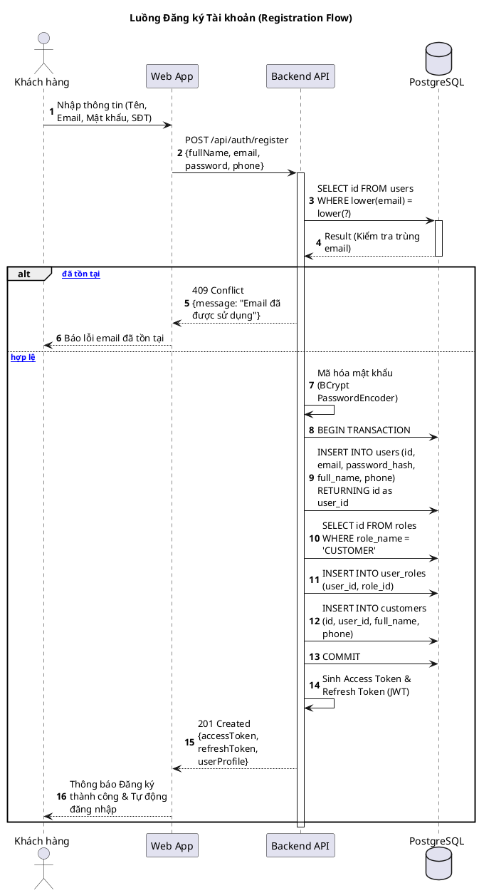
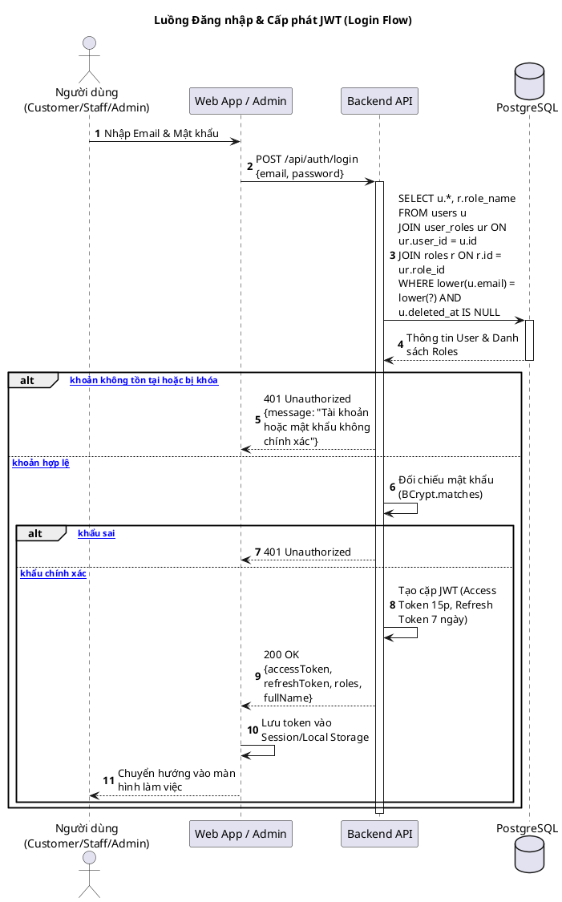
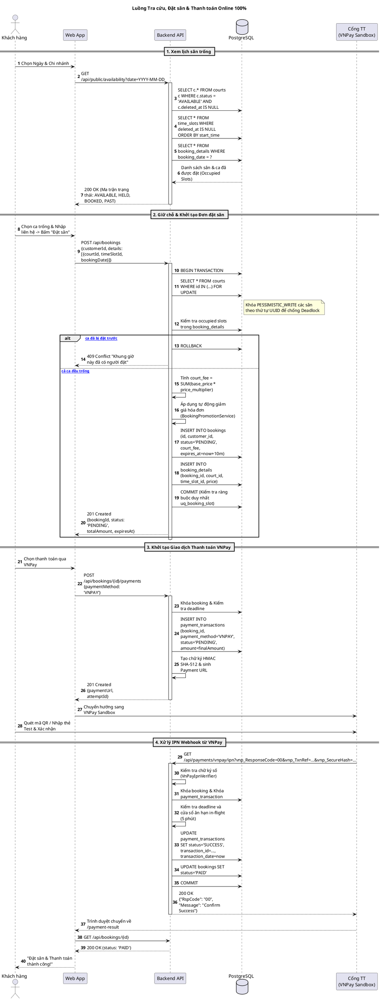
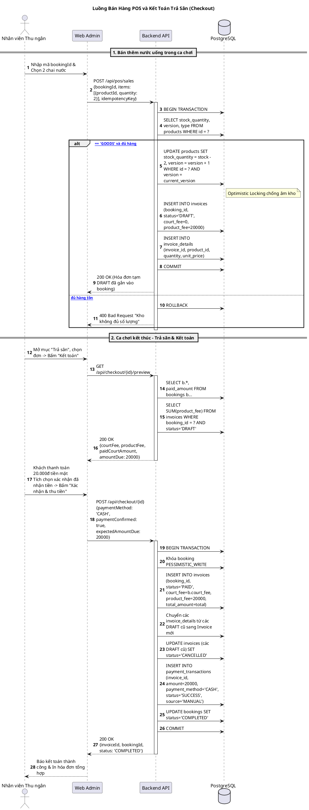
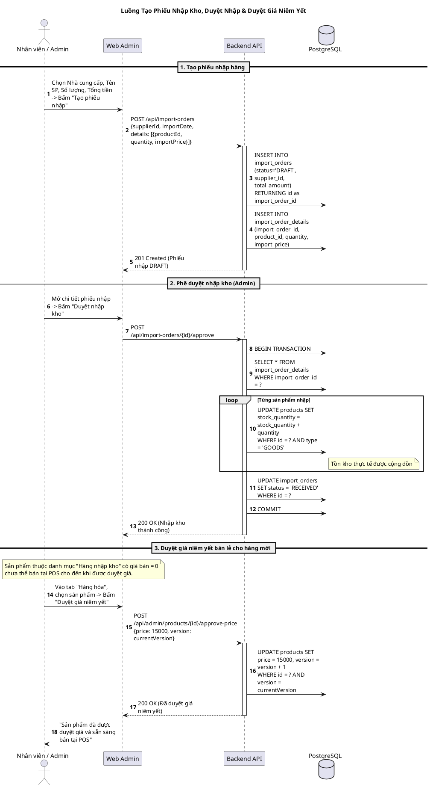

# Sơ đồ Sequence (Tuần tự) - Hệ thống Đặt Sân Cầu Lông (Bản Đồng Bộ V5)

Sơ đồ Sequence mô phỏng chi tiết tương tác tuần tự giữa Người dùng (Actors), Giao diện (Web App / Web Admin), Backend API (Spring Boot) và Cơ sở dữ liệu (PostgreSQL) cùng Cổng thanh toán (VNPay Sandbox).

> **Hướng dẫn xem hình:** Copy từng đoạn mã PlantUML bên dưới và dán vào công cụ xem trực quan như **[PlantText](https://www.planttext.com/)** hoặc **[Mermaid Live Editor](https://mermaid.live/)**.

---

## 1. Luồng Đăng Ký Tài Khoản Khách Hàng (Registration Flow)

---

## 2. Luồng Đăng Nhập & Xác Thực (Login Flow)

---

## 3. Luồng Tra Cứu, Đặt Sân & Thanh Toán Online (Booking & VNPay Flow)

---

## 4. Luồng Bán Hàng POS và Kết Toán Trả Sân (Checkout Flow)

---

## 5. Luồng Quản Lý Nhập Kho & Duyệt Giá Bán (Inventory Flow)

