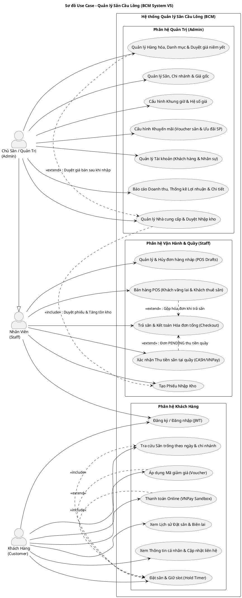

# Sơ đồ Use Case - Hệ thống Quản lý Sân Cầu Lông (Bản Đồng Bộ V5)

Tài liệu này phản ánh chính xác cấu trúc nghiệp vụ và hệ thống phân quyền 3 nhóm người dùng (Actors) theo đúng mã nguồn và CSDL thực tế: Khách Hàng (Customer), Nhân Viên (Staff) và Quản Trị Viên / Chủ Sân (Admin).

> **Lưu ý nghiệp vụ trọng tâm:**
> 1. **Chính sách không hủy sân sau thanh toán (No Cancellation / No Refund):** Khách hàng không được phép tự hủy đơn đặt sân sau khi đã thanh toán thành công (CSDL không có trạng thái `CANCELLED` hay quy trình hoàn tiền tự động).
> 2. **Vòng đời đơn đặt sân (Booking Lifecycle):** Chỉ gồm 4 trạng thái chuẩn hóa: `PENDING → PAID → COMPLETED` (hoặc `PENDING → EXPIRED` khi quá hạn giữ chỗ 10 phút).
> 3. **Phương thức thanh toán:** Khách đặt online thanh toán 100% qua **VNPay Sandbox**. Tại quầy thu ngân (POS / Checkout), hỗ trợ **Tiền mặt (CASH)** và **VNPay**.

---

## Mã nguồn PlantUML

---

## Chi tiết Đặc tả Use Case

### 1. Phân hệ Khách hàng (Customer)
* **UC1 - Đăng ký / Đăng nhập:** Đăng ký tài khoản khách hàng mới, đăng nhập nhận cặp mã thông báo JWT (Access Token & Refresh Token stateless).
* **UC2 - Tra cứu Sân trống:** Xem ma trận sân - khung giờ khả dụng theo từng ngày và theo chi nhánh; tự động nhận diện các ca đã được giữ chỗ (`HELD`), đã đặt (`BOOKED`) hoặc ca trong quá khứ (`PAST`).
* **UC3 - Đặt sân & Giữ slot:** Khởi tạo đơn đặt sân ở trạng thái `PENDING`, thiết lập bộ đếm thời gian giữ chỗ (Hold duration: 10 phút). Pessimistic Lock và Unique Constraint bảo đảm không trùng lịch.
* **UC4 - Áp dụng Mã giảm giá:** Áp dụng giảm giá tự động theo bậc hóa đơn hoặc nhập mã Voucher hợp lệ (`NEWMEMBER`, `KMKH10`). Khóa ưu đãi không cho thay đổi khi đã bắt đầu thanh toán.
* **UC5 - Thanh toán Online:** Khởi tạo yêu cầu thanh toán VNPay Sandbox, mở cổng thanh toán; xử lý xác nhận giao dịch qua IPN Callback an toàn để chuyển đơn sang `PAID`.
* **UC6 - Xem Lịch sử Đặt sân:** Tra cứu danh sách các đơn đặt sân trong quá khứ, xem chi tiết biên lai, trạng thái thanh toán và mã giao dịch đối soát.
* **UC7 - Thông tin cá nhân & Quản lý giữ chỗ:** Xem thông tin tài khoản `/users/me`, điều chỉnh số điện thoại/họ tên liên hệ trên đơn đang chờ thanh toán, và gia hạn/nhả giữ chỗ tạm thời (`leaveCheckout`/`resumeCheckout`).

### 2. Phân hệ Vận hành & Quầy Thu Ngân (Staff)
* **UC8 - Bán hàng POS:** Bán nước uống, phụ kiện, vợt, cầu lông và dịch vụ:
  * *Khách vãng lai:* Thu tiền ngay (CASH hoặc VNPay), sinh hóa đơn `PAID`, tự động trừ kho hàng hóa có kiểm soát Optimistic Locking.
  * *Khách thuê sân:* Gắn sản phẩm vào mã booking của khách, lưu hóa đơn tạm `DRAFT`.
* **UC9 - Xác nhận Thu tiền sân tại quầy:** Cho phép nhân viên xác nhận thu tiền mặt (CASH) hoặc VNPay tại quầy cho các đơn khách đặt trước đang ở trạng thái `PENDING`, chuyển đơn sang `PAID` và ghi nhận biên lai thu tiền.
* **UC10 - Trả sân & Kết toán Hóa đơn tổng (Checkout):** Khi ca chơi kết thúc, nhân viên kiểm tra tổng bill (Tiền sân sau giảm + Tiền hàng tại quầy - Giảm giá hàng), đối trừ số tiền sân khách đã thanh toán trước, thu phần chênh lệch còn lại (nếu có), xuất một hóa đơn hoàn tất duy nhất (`PAID`) và chuyển trạng thái booking sang `COMPLETED`.
* **UC11 - Quản lý Đơn hàng nháp POS:** Xem danh sách giao dịch bán hàng, cho phép hủy hóa đơn tạm `DRAFT` và tự động hoàn trả tồn kho nguyên vẹn cho sản phẩm.
* **UC12 - Tạo Phiếu Nhập Kho:** Lập phiếu nhập hàng từ nhà cung cấp, nhập số lượng và tổng tiền nhập hàng ở trạng thái chờ duyệt (`DRAFT`).

### 3. Phân hệ Quản trị (Admin)
* **UC13 - Quản lý Sân, Chi nhánh & Giá gốc:** Thêm, sửa thông tin sân, địa chỉ quận/huyện, loại thảm sân, trạng thái sân (`AVAILABLE`, `MAINTENANCE`, `CLOSED`), thiết lập giá gốc cơ bản. Chặn chuyển bảo trì/xóa nếu sân đang có lịch đặt active.
* **UC14 - Cấu hình Khung giờ & Hệ số giá:** Quản lý danh mục khung giờ hoạt động, kiểm tra không chồng lấn giờ, định cấu hình hệ số giá giờ cao điểm (`1.50`) và giờ thường (`1.00`).
* **UC15 - Quản lý Hàng hóa, Danh mục & Duyệt giá:** CRUD danh mục và sản phẩm; cơ chế kiểm soát 2 bước: bắt buộc Admin duyệt giá bán lẻ niêm yết cho hàng nhập kho mới trước khi quầy POS được phép bán.
* **UC16 - Quản lý Nhà cung cấp & Duyệt Nhập kho:** Quản lý thông tin nhà cung cấp đối tác; phê duyệt phiếu nhập kho (`RECEIVED`), tự động cộng dồn số lượng tồn kho `stock_quantity`.
* **UC17 - Quản lý Khuyến mãi:** Thiết lập và quản lý các chương trình ưu đãi tiền sân (theo giá trị bill hoặc mã voucher) và chính sách giảm giá sản phẩm POS.
* **UC18 - Quản lý Tài khoản & Phân quyền:** Xem danh sách tài khoản người dùng, phân loại khách hàng / nhân viên, chỉnh sửa thông tin liên hệ, thực hiện khóa/mở khóa tài khoản an toàn (bảo vệ tài khoản khách vãng lai và không cho phép tự khóa tài khoản Admin cuối cùng).
* **UC19 - Báo cáo & Thống kê Tài chính:**
  * Báo cáo Doanh thu theo Ngày / Tuần / Tháng / Khoảng ngày tùy chọn.
  * Thống kê Thu - Chi nhập hàng - Lợi nhuận gộp theo Tháng / Quý / Năm.
  * Báo cáo chi tiết doanh thu phân bổ theo nhân viên thu ngân, theo khách hàng, theo mặt hàng sản phẩm và theo từng sân.
